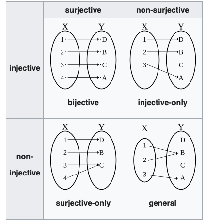

# 1. 강의영상



# 2. 수학과에서 자주 쓰는 

## A. 수학과에서 자주 쓰는 기호

`-` 아래와 같은 기호들의 의미를 알고 있는가? 

- $\because$
- $\therefore$

`-` 이처럼 수학에서는 특별한 의미를 가지는 몇 가지 기호가 있다. 

`-` 아래는 특별한 의미를 가지는 수학기호들의 모음이다.

| 언어                  | 기호                                |
|-----------------------|-------------------------------------|
| for all               | ∀                                   |
| exists                | ∃                                   |
| such that, satisfying | s.t., st                            |
| if-then, implies      | ⇒                                   |
| if and only if        | ⇔                                   |
| quod erat demonstrandum | □, ■                                |

`# 예시1`: 아래의 문장

> "모든 실수 $x$에 대하여, $x^2$은 0 이상이다."

을 다양하게 표현하여 보자.

(언어)

- for any $x$ in $\mathbb{R}$, $x^2 \geq 0$. 
- for arbitrary $x \in \mathbb{R}$, $x^2 \geq 0$. 
- if $x \in \mathbb{R}$, then $x^2 \geq 0$. 

(기호)

- $\forall x \in \mathbb{R}$: $x^2\geq 0$. 
- $\forall x \in \mathbb{R}$, $x^2\geq 0$. 
- $x^2 \geq 0$, for all $x \in \mathbb{R}$. 
- $x^2 \geq 0$, $\forall x \in \mathbb{R}$. 
- $x \in \mathbb{R} \Rightarrow x^2 \geq 0$. 

> 어떻게 쓰느냐에 대한 규칙은 없음. 거의 쓰는 사람 마음임. (그런데 뉘앙스는 조금씩 다름)

`#`

`# 예시2`: 이번에는

> "$\Omega$의 임의의 부분집합 $A$,$B$에 대하여, $A=B$ 일 필요충분조건은 $A\subset B$ 이고 $B \subset A$ 이어야 한다."

라는 문장을 다양하게 표현하여 보자. 

(언어)

- For all $A,B \subset \Omega$, $A=B$ if and only if (1) $A \subset B$ and (2) $B \subset A$. 
- Consider $A,B \subset \Omega$. $A=B$ if and only if (1) $A \subset B$ and (2) $B \subset A$. 

(기호)

- $A = B \Leftrightarrow A \subset B \text{ and } B \subset A, \forall A,B \subset \Omega$. 
- $A = B \Leftrightarrow \big(A \subset B \text{ and } B \subset A\big), \forall A,B \subset \Omega$. 
- $\forall A,B \subset \Omega$: $A = B \Leftrightarrow \big(A \subset B \text{ and } B \subset A\big)$

> 의미가 좀 모호해질 수도 있는데, "눈치껏" 알아 먹어야 한다. 

`#`

## B. 귀류법

`-` 귀류법: **니 논리대로면...** <- 인터넷 댓글에 많음.. 

:::{.callout-note}
님 논리대로면.. (ref: [하이브레인넷](https://m.hibrain.net/braincafe/cafes/38/posts/205/articles/466461?pagekey=466461&listType=TOTAL&pagesize=5&sortType=RDT&limit=30&displayType=TIT&siteid=1&page=1))

- XXX가 문제 없으면 서울 전체가 문제가 없고 (애초에 서울은 문제도 아니라는데 왜 이소리는 하고 계신지 모르겠지만)
- 수도권 모 대학이 문제가 없으면 전체가 문제가 없겠네요?
- 지방도 1개 대학이 문제가 없으니 전체가 문제 없겠네요?
와우! 모든 문제가 해결되었습니다! 출산율 감소로 인한 한국대학의 위기가 해결되었.. 아니 애초에 위기가 없었군요!.
어휴.. ㅠㅠ

:::

`-` 섀도복싱 

- 상대가 없는 허공에 대고 샌드백 없이 권투 연습을 하는 것. 
- 인터넷 상에서는 혼자서 허공에 대고 공격한다는 의미로 사용되고 있음. 어휘의 원래 뜻과 마찬가지로 아무도 뭐라 하지 않았는데 혼자 가상의 공격 상대를 만들어 놓고 비판하거나 욕하는 모습을 표현할 때 많이 쓰임. (출처: 나무위키)

`# 기습질문` -- (지난시간의 난제) 바늘이 하나 있는 시계에서, 바늘을 랜덤으로 돌려서 딱 6시에 멈출 확률이 0이어야 하는 이유? 

(풀이)

::: {.callout-note title="수업시간설명" collapse="true"}
아래와 같이 주장하는 상대가 있다고 가정하자. (섀도복싱을 위한 가상의 상대 설정)

> 어떤사람: $P(\{\pi\})$는 0이 아니에요. 

이 사람의 주장이 맞다고 생각하자. 이 주장은 아래와 같이 볼 수 있다. 

> 어떤사람: $P(\{\pi\})=a$이다. 단 $0<a<1$. 

그 사람의 주장대로라면 아래가 성립한다. 

- $P(\{\pi\})=a$
- $P(\{\pi/2\})=a$ // 6시에 바늘이 정확하게 설 확률이 $a$이면 3시에 바늘이 정확하게 설 확률도 $a$니까 
- $P(\{\pi/3\})=a$
- $P(\{\pi/4\})=a$
- ...

그러면 아래가 성립한다. 

$$P(\{\pi\}\cup \{\pi / 2\} \cup \dots)=P(\{\pi\})+P(\{\pi / 2\})+\dots=\infty \times a > 1$$
따라서 그 어떤사람은 사실 확률이 1보다 크다는 사실을 주장한 셈이다. 이는 모순이다. 따라서 $P(\{\pi\})=0$이다. 
:::

## C. 추상화(일반화)

`-` 연필이란? 필기도구의 하나. 흑연과 점토의 혼합물을 구워 만든 가느다란 심을 속에 넣고, 겉은 나무로 둘러싸서 만든다. 1565년에 영국에서 처음으로 만들었다. (출처: 네이버국어사전)

`# 질문`: 아래는 연필인가? 

- 새로운 개념을 적용해야 하는 어떠한 일이 있을 때, 사람들은 익숙한 정의에서 확장을 하기를 원한다. 확장을 하는 방식은 익숙한 정의에 의해 파생되는 성질을 이용하여 (혹은 성질들을 조합하여), "마치 정의처럼" 쓰는 것이다. 
- 수학에서는 약속에 의하여 성질이 생기고, 그 성질로부터 확장된 약속이 생기는 것은 매우 흔한 일이다. 

`-` 리처드 파인만: "수학자들은 가급적 일반적인 추론을 선호합니다." (2:28부터)

> ref: <https://www.youtube.com/watch?v=z-BSIzNLjfk>

- 일반화된 이론의 특징1: 더 많은 걸 설명한다. 
- 일반화된 이론의 특징2: 특수한 상황을 안아(?)준다. 

# 3. Size와 Cardinality

`-` 집합 $A$의 cardinality는 집합에 들어있는 "원소의 수"를 좀 더 일반화한 개념이다. 집합 $A$가 유한집합일 경우는 우리에게 익숙한 `size`의 개념을 그대로 사용하면 된다. 예를 들어 집합 $A = \{2,3,4\}$ 일 경우는 

$$\text{cardinal number of } A := |A| = 3$$

와 같이 사용하면 된다. 만약에 집합 $A$가 무한집합이라면 그 동작원리가 조금 복잡하다. 

`-` 오늘의 목표: 집합의 `size`개념을 일반화하자! (그래서 카디널리티라는 개념을 만들자)

- 익숙한 개념: 두 집합 $A$,$B$의 size 비교 (단, $A$와 $B$는 유한집합)
- 파생되는 성질: 두 집합 $A$, $B$사이에 전사, 단사, 전단사 함수가 존재할 때 size 비교?
- 개념의 확장: 두 집합 $A$,$B$의 cardinality 비교 (이때 $A$와 $B$는 무한집합일 수도 있음)

## A. 전사/단사/전단사

`-` 용어 정리 

- injective = one-to-one = 단사 = 일대일 함수
- surjective = onto = 전사 = 위로의 함수 
- bijective = one-to-one and onto, one-to-one correspondence = 전단사 = 일대일 대응 

`-` ref: <https://en.wikipedia.org/wiki/Bijection,_injection_and_surjection>

`-` 따지는 방법
    
- 단사: 함수 $f$는 $X$에서 $Y$로 향하는 단사함수이다. $\Leftrightarrow$ $\forall x_1,x_2 \in X$: $x_1\neq x_2 \Rightarrow f(x_1)\neq f(x_2)$
- 전사: 함수 $f$는 $X$에서 $Y$로 향하는 전사함수이다. $\Leftrightarrow$ $\forall y \in Y ~\exists x \in X$ such that $f(x)=y$. 

`-` 성질1: 어떤 함수가 전사함수 & 단사함수 $\Leftrightarrow$ 전단사함수 

`-` 성질2: 

- 집합 $X$에서 집합 $Y$로 가는 단사함수 $f$가 존재한다. $\Rightarrow$ $|X| \leq |Y|$
- 집합 $X$에서 집합 $Y$로 가는 전사함수 $f$가 존재한다. $\Rightarrow$ $|X| \geq |Y|$

`-` 성질1~2로 유추하면 아래와 같은 사실을 주장할 수 있지 않을까? 

- 집합 $X$에서 집합 $Y$로 향하는 전단사함수가 존재한다 $\Rightarrow$ $|X|=|Y|$

`-` 확장된 정의: 두 집합 $X$, $Y$를 고려하자. $(\star\star\star\star\star)$

- $|X|\leq |Y|$ $\Leftrightarrow$ $X$에서 $Y$로 향하는 단사함수가 존재한다. 
- $|X|\geq |Y|$ $\Leftrightarrow$ $X$에서 $Y$로 향하는 전사함수가 존재한다. 
- $|X|=|Y|$ $\Leftrightarrow$ $X$에서 $Y$로 향하는 전단사함수가 존재한다. 

## B.  두 집합의 카디널리티 비교

`# 예제1` 

집합 $X=\{1,2,3\}$, $Y=\{2,4,6\}$을 생각하자. 적당한 함수 $f$를 아래와 같이 정의하자. 

- $f(1)=2$
- $f(2)=4$
- $f(3)=6$

함수 $f$의 성질을 체크해보자. 

1. (단사) $\forall x_1,x_2 \in X$: $x_1\neq x_2$ $\Rightarrow$ $f(x_1)\neq f(x_2)$.
2. (전사) $\forall y \in Y~ \exists x \in X$ such that $f(x)=y$.

함수 $f$는 전단사 함수이다. 집합 $X$에서 집합 $Y$로 가는 전단사 함수가 존재하므로 집합 $X$와 집합 $Y$의 카디널리티는 동일하다. 

::: {.callout-note title="수업시간설명" collapse="true"}

사실 직관적으로 $f$는 전단사임을 알 수 있는데, 좀 더 기호에 익숙해지기 위해서 아래의 조건을 엄밀하게 따져보자. 

1. (단사) $\forall x_1,x_2 \in X$: $x_1\neq x_2$ $\Rightarrow$ $f(x_1)\neq f(x_2)$.
2. (전사) $\forall y \in Y~ \exists x \in X$ such that $f(x)=y$.

단사를 체크하자.

| case | $x_1$ | $x_2$ | $f(x_1)$ | $f(x_2)$ |
|:---:|:---:|:---:|:---:|:---:|
| $\color{gray}{1}$ | $\color{gray}{1}$ | $\color{gray}{1}$ | $\color{gray}{2}$ | $\color{gray}{2}$ |
| 2 | $1$ | $2$ | $2$ | $4$ |
| 3 | $1$ | $3$ | $2$ | $6$ |
| 4 | $2$ | $1$ | $4$ | $2$ |
| $\color{gray}{5}$ | $\color{gray}{2}$ | $\color{gray}{2}$ | $\color{gray}{4}$ | $\color{gray}{4}$ |
| 6 | $2$ | $3$ | $4$ | $6$ |
| 7 | $3$ | $1$ | $6$ | $2$ |
| 8 | $3$ | $2$ | $6$ | $4$ |
| $\color{gray}{9}$ | $\color{gray}{3}$ | $\color{gray}{3}$ | $\color{gray}{6}$ | $\color{gray}{6}$ |

<!-- colwidths: 4 4 4 4.2 4.2 -->

$x_1 \neq x_2$ 라는 조건이 있으므로, 위에서 case 1,5,9 는 고려하지 않아도된다. case 2,3,4,6,7,8 에서는 (즉 $x_1\neq x_2$에서는) 항상 두 함수값 $f(x_1),f(x_2)$이 다르므로 $\forall x_1,x_2 \in X$: $x_1\neq x_2$ $\Rightarrow$ $f(x_1)\neq f(x_2)$. 

전사를 체크하자. (아래 표에서 $\exists x?$ 는 $f(x)=y$를 만족하는 $x$가 존재하는가를 뜻한다.)

| case | $y$ | $f(x)=y$ | $\exists x?$ |
|:---:|:---:|:---:|:---:|
| 1    | $2$ | $f(x)=2$ | $x=1$ |
| 2    | $4$ | $f(x)=4$ | $x=2$ |
| 3    | $6$ | $f(x)=6$ | $x=3$ |

<!-- colwidths: 4 4 4 4.2 -->
따라서 $\forall y \in Y~ \exists x \in X$ such that $f(x)=y$.
:::

`#`

`# 예제2` 

집합 $X=\{1,2,3,\dots \}$, $Y=\{0,1,2,\dots \}$을 생각하자. 함수 $f$를 아래와 같이 정의하자. 

- $f(1)=0$
- $f(2)=1$
- $f(3)=2$
- $\dots$

함수 $f$의 성질을 체크해보자. 

1. (단사) $\forall x_1,x_2 \in X$: $x_1\neq x_2$ $\Rightarrow$ $f(x_1)\neq f(x_2)$
2. (전사) $\forall y \in Y~ \exists x \in X$ such that $f(x)=y$. 

함수 $f$는 전단사함수이다. 집합 $X$에서 집합 $Y$로 가는 전단사 함수가 존재하므로 집합 $X$와 집합 $Y$의 카디널리티는 동일하다.^[살짝 어질어질하죠?]

`#`

`-`  $\aleph_0$의 정의: 자연수 집합의 카디널리티 (최소의 무한 기수)를 $\aleph_0$이라고 정의한다. 즉 

$$|\mathbb{N}|=\aleph_0$$

이다. 

`-` 놀라운 사실1: 

- 음이 아닌 정수의 집합 $\mathbb{N} \cup \{0\}$의 카디널리티 역시 $\aleph_0$이다. 

`-` 놀라운 사실2: 

- 자연수집합은 음이 아닌 정수집합의 진 부분집합인데, 카디널리티가 같다. 즉 $A \subsetneq B$ 인데, $|A|=|B|$ 인 상황. 
- 즉 무한집합의 경우, 본인과 카디널넘버가 같은 진 부분집합이 존재할 수 있다. (유한집합에서는 불가능하겠지) 

:::{.callout-note}

깨알같이 소개하는 무한집합의 정의: 

집합 $A$가 무한집합이다. $\Leftrightarrow$ $A$와 동일한 카디널리티를 가지는 $A$의 진 부분집합이 존재한다. 

:::

`# 예제3` 

집합 $X=\{1,2,3,\dots \}$, $Y=\{2,4,6,\dots \}$을 생각하자. 함수 $f$를 아래와 같이 정의하자. 

- $f(1)=2$
- $f(2)=4$
- $f(3)=6$
- $\dots$

함수 $f$의 성질을 체크해보자. 

1. (단사) $\forall x_1,x_2 \in X$, $x_1\neq x_2$ $\Rightarrow$ $f(x_1)\neq f(x_2)$? 
2. (전사) $\forall y \in Y~ \exists x \in X$ such that $f(x)=y$. 

1과 2이 모두 성립하므로 함수 $f$는 전단사함수이다. 집합 $X$에서 집합 $Y$로 가는 전단사 함수가 존재하므로 집합 $X$와 집합 $Y$의 카디널리티는 동일하다. 

::: {.callout-note title="수업보충설명" collapse="true"}

언뜻 생각하면 $|Y| = |X| + 1$ 과 같은 관계가 성립할 것 같다. 

그렇지만 그렇지 않다. $f(x)=x-1$ 로 정의한 함수 $f$가 $X$에서 $Y$로 가는 전단사함수이기 때문이다. 

1. (단사) 임의의 $x_1, x_2 \in X$에 대하여 $x_1 \neq x_2$ 이면 $f(x_1)=x_1-1 \neq x_2-1=f(x_2)$ 이므로 단사이다. 
2. (전사) 임의의 $y \in Y$에 대하여 $x=y+1$ 로 두면 $x \in X$ 이고 $f(x)=y$ 이므로 전사이다. 

따라서 $f$는 전단사함수이고, $|X|=|Y|$ 이다. 

:::

`#`
