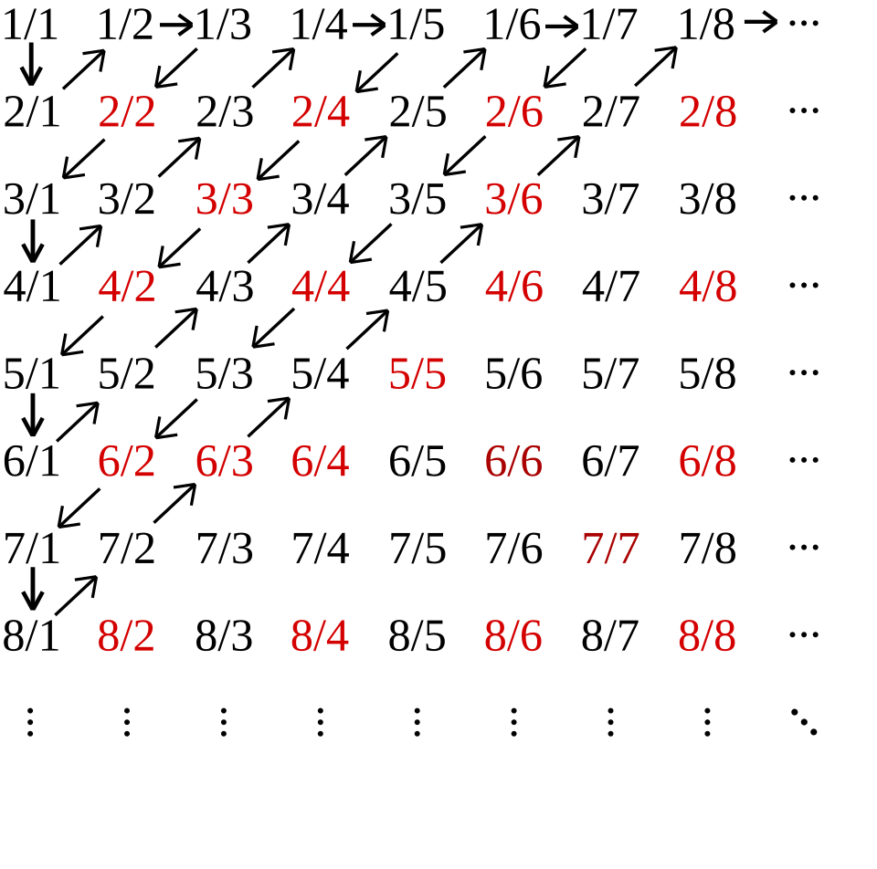

# 1. 강의영상



# 2. Size와 Cardinality (계속)

`-` 복습

- 우리가 궁금했던 것: 유리수와 무리수 중 어느 쪽이 더 많을까?
- 전통적으로 두 집합 $A$, $B$의 크기를 비교하는 방법

    1. $A$와 $B$의 원소의 수를 각각 센다.
    2. 1에서 센 원소의 수를 비교한다.

- 특이한 방식으로 두 집합 $A$, $B$의 크기를 비교하는 방법

    1. $A \to B$인 단사함수가 있으면 $|A| \leq |B|$이다.
    2. $A \to B$인 전사함수가 있으면 $|A| \geq |B|$이다.   
	3. $A \to B$인 전단사함수가 있으면 $|A| = |B|$이다.

- 비직관적인 결과: 자연수집합의 카디널리티와 짝수집합의 카디널리티가 같다.

`-` 약간의 이해를 돕기 위한 직관적인 표 

| $n$  | $1$ | $2$ | $3$ | $4$ | ... |
| ---- | --- | --- | --- | --- | --- |
| $2n$ | $2$ | $4$ | $6$ | $8$ | ... |

<!-- colwidths: 3.9 3.9 3.9 3.9 3.9 3.9 -->

(1) 위와 같은 표를 만들 수 있고 (2) 각 행의 숫자들에 중복이 없다면 두 행의 카디널리티는 같다. (따라서 위의 표를 보면 자연수집합과 짝수집합의 카디널리티가 같음을 직관적으로 알 수 있다.)

`-` 자연수/홀수/짝수/정수의 카디널리티

- 자연수집합 $\mathbb{N}$의 카디널리티는 $\aleph_0$이다. (정의)
- 짝수인 자연수 집합의 카디널리티는 $\aleph_0$이고, 홀수인 자연수 집합의 카디널리티도 $\aleph_0$이다. 
- 정수집합 $\mathbb{Z}$의 카디널리티 역시 $\aleph_0$이다. 

`-` 홀수집합과 짝수집합의 카디널리티가 같은 이유는?

(표로 해석)

| $\mathbb{N}_{odd}$ (홀수) | $1$ | $3$ | $5$ | $7$ | ... |
| ---- | --- | --- | --- | --- | --- |
| $\mathbb{N}_{even}$ (짝수) | $2$ | $4$ | $6$ | $8$ | ... |

<!-- colwidths: 3.9 3.9 3.9 3.9 3.9 3.9 -->

(엄밀하게)

홀수집합을 $A$, 짝수집합을 $B$라고 하자. $f: A \to B$를 $f(x)=x+1$로 두면 $f$는 전단사함수이다. 따라서 $|A| = |B|$이다.

`-` 홀수집합과 자연수집합의 카디널리티가 같은 이유는?

(표로 해석)

| $\mathbb{N}_{odd}$ (홀수) | $1$ | $3$ | $5$ | $7$ | ... |
| ---- | --- | --- | --- | --- | --- |
| $\mathbb{N}$ (자연수) | $1$ | $2$ | $3$ | $4$ | ... |

<!-- colwidths: 3.9 3.9 3.9 3.9 3.9 3.9 -->

(엄밀하게)

홀수집합을 $A$라고 하자. $f: A \to \mathbb{N}$을 $f(x)=\frac{x+1}{2}$로 두면 $f$는 전단사함수이다. 따라서 $|A| = |\mathbb{N}|$이다.

`-` 자연수집합과 정수집합의 카디널리티가 같은 이유는?

(표로 해석)

| $\mathbb{N}$ (자연수) | $1$ | $2$ | $3$ | $4$ | $5$ | ... |
| --- | --- | --- | --- | --- | --- | --- |
| $\mathbb{Z}$ (정수) | $0$ | $1$ | $-1$ | $2$ | $-2$ | ... |

<!-- colwidths: 3.9 3.9 3.9 3.9 3.9 3.9 3.9 -->

(엄밀하게)

$f: \mathbb{N} \to \mathbb{Z}$를 아래와 같이 두자.

$$f(n)=\begin{cases} \frac{n}{2} & n \text{ even} \\ -\frac{n-1}{2} & n \text{ odd} \end{cases}$$

그러면 $f(1)=0$, $f(2)=1$, $f(3)=-1$, $f(4)=2$, $\dots$ 이고 $f$는 전단사함수이다. 짝수는 양의 정수로, 홀수는 $0$ 이하의 정수로 가므로 서로 겹치지 않고(단사), 양의 정수 $k$는 $f(2k)$로, $0$ 이하의 정수 $-k$는 $f(2k+1)$로 모두 나온다(전사). 따라서 $|\mathbb{N}| = |\mathbb{Z}|$이다.

## A. 카디널리티의 유용한 개념

`# 개념1` -- $A \subset B$ 라면, 항상 $A$에서 $B$로 가는 단사함수가 존재한다. 즉 $|A| \leq |B|$ 가 성립한다. 

(왜?) 

$f: A \to B$ 인 함수 $f$를 항등함수로 잡으면 이 함수는 단사이다. 

{width=45%}

`#`

`# 예제1` -- 아래의 수열을 고려하자. 
$$0,\frac{1}{2}, \frac{2}{2}, \frac{1}{3}, \frac{2}{3}, \frac{3}{3}, \dots $$
이 수열의 원소들로 이루어진 집합 $A$의 카디널리티가 $\aleph_0$임을 보여라.

`(풀이1)`

아래의 표를 관찰하자.

| $n$ | $1$ | $2$ | $3$ | $4$ | $5$ | $6$ | $7$ | $8$ | $9$ | $10$ | $11$ |
| --- | --- | --- | --- | --- | --- | --- | --- | --- | --- | --- | --- |
| $a(n)=a_n$   | $0$ | $1/2$ | $2/2$ | $1/3$ | $2/3$ | $3/3$ | $1/4$ | $2/4$ | $3/4$ | $4/4$ | $1/5$ |

<!-- colwidths: 2 2 2 2 2 2 2 2 2 2 2 2 -->

아래 행에는 겹치는 원소가 있다. 예를 들어 $a_3=\frac{2}{2}$와 $a_6=\frac{3}{3}$은 둘 다 $1$이고, $a_2=\frac{1}{2}$와 $a_8=\frac{2}{4}$는 둘 다 $\frac{1}{2}$이다. 그래서 이 표만 보고 바로 두 행의 카디널리티가 같다고 할 수는 없다.

그렇지만 $|\mathbb{N}| \geq |A|$임은 알 수 있다. 직관적으로는, 아래 행이 $A$의 원소를 겹치는 것까지 포함해서 나열하고 있으니 $A$의 원소가 $\mathbb{N}$의 원소보다 많을 수는 없다. 좀 더 엄밀하게는 $a: \mathbb{N} \to A$가 전사함수이기 때문이다. 즉 모든 $x \in A$에 대하여 $a(n)=x$인 $n$이 최소한 하나는 있다. 실제로

- $x=0$ 에는 $n=1$
- $x=\frac{1}{2}$ 에는 $n=2$ (그리고 $n=8$)
- $x=1$ 에는 $n=3$ (그리고 $n=6$, $n=10$)
- $x=\frac{1}{3}$ 에는 $n=4$, $\quad x=\frac{2}{3}$ 에는 $n=5$, $\quad x=\frac{1}{4}$ 에는 $n=7$, $\quad \dots$

와 같이 대응되고, 일반적으로 $x=\frac{p}{q}$ $(1 \leq p \leq q,\ q \geq 2)$는 $n=\frac{q(q-1)}{2}+p$ 번째에 나온다. (이 수업에서는 굳이 이렇게까지 수식화 할 필요는 없다, 표로 이해만해도 충분함)

아무튼 $|\mathbb{N}| \geq |A|$는 나왔으니, 이제 $|\mathbb{N}| \leq |A|$만 보이면 된다.

이를 위해서는 $\mathbb{N}$에서 $A$로 가는 단사함수를 아무거나 하나 제시하면 된다. 예를 들어 $f(n)=\frac{1}{n}$으로 두면 $f(n) \in A$이고 ($f(1)=1=\frac{2}{2}$), $n \neq m$이면 $\frac{1}{n} \neq \frac{1}{m}$이므로 $f$는 단사함수이다. 따라서 $|\mathbb{N}| \leq |A|$이고, 앞의 결과와 합치면 $|A| = |\mathbb{N}| = \aleph_0$이다.

`(풀이2)` 아래와 같은 표를 고려하자. 

| $n$        | $1$ | $2$ | $3$ | $4$ | $5$ | $6$ | $7$ | $8$ | $\cdots$ |
| :--------- | :-- | :-- | --- | --- | --- | --- | --- | --- | -------- |
| $b(n)=b_n$ | $1$ | $2$ | $3$ | $4$ | $5$ | $7$ | $9$ | $11$ | $\cdots$ |
| $a(b_n)$   | $0$ | $1/2$ | $2/2$ | $1/3$ | $2/3$ | $1/4$ | $3/4$ | $1/5$ |          |

<!-- colwidths: 4.4 2.4 2.4 2.4 2.4 2.4 2.4 2.4 2.4 4.4 -->

이 표의 세 행에는 각각 겹치는 원소가 없으므로, 세 행의 카디널리티가 모두 같음을 직관적으로 알 수 있다. 그런데 첫 행은 자연수집합 $\mathbb{N}$이고 세 번째 행은 집합 $A$이다. 즉 $f(n)=a(b_n)$으로 두면 $f$는 $\mathbb{N}$에서 $A$로 가는 전단사함수이므로 바로 $|A| = |\mathbb{N}|$임을 알 수 있다.

:::{.callout-note}
집합을 $A=\{a_1,a_2,a_3,\dots\}$와 같이 쓴다는 것은 그 자체로 $a_1,a_2,a_3,\dots$이 서로 다른 수라는 것을 의미한다. 집합은 중복된 원소를 허용하지 않기 때문이다. 그래서 $A=\{1,1,2\}$와 같은 것은 집합이라고 하지 않는다.
:::

`# 개념2` -- 무한집합 $A$를 아래와 같이 쓸 수 있다면

$$ A = \{a_1,a_2,a_3,\dots \}$$
집합 $A$의 cardinality는 $\aleph_0$이다. 

`#`

`-` 개념2의 역도 성립한다. 즉 어떠한 무한집합의 카디널리티가 $\aleph_0$이면 그 무한집합의 원소는 원소나열법으로 표현할 수 있다. 따라서 아래는 모두 같은 말이다.

- 무한집합 $A$의 원소를 수열 $a_1, a_2, a_3, \dots$로 나열할 수 있다. (중복이 있어도 된다. 풀이2처럼 중복을 건너뛰면 되기 때문이다. $1, 1, 1, \dots$처럼 값이 유한개뿐인 수열은 $A$가 무한집합이라는 조건에서 이미 빠진다.)
- 무한집합 $A$를 원소나열법으로 표현할 수 있다. 
- 무한집합 $A$의 카디널리티는 $\aleph_0$이다. 

`#`

`# 예제2` -- 이 개념을 이용하여 아래 집합의 카디널리티를 구해 보자.

$$B=\{-44,-2,0\} \cup \mathbb{N}$$

(표로 해석)

| $\mathbb{N}$ (자연수) | $1$ | $2$ | $3$ | $4$ | $5$ | $6$ | $7$ | ... |
| ------- | --- | --- | --- | --- | --- | --- | --- | --- |
| $B$ | $-44$ | $-2$ | $0$ | $1$ | $2$ | $3$ | $4$ | ... |

<!-- colwidths: 8 3.8 3.8 3.8 3.8 3.8 3.8 3.8 3.8 -->

아래 행에는 겹치는 원소가 없고 $B$의 원소가 빠짐없이 나온다. 즉 $B$의 원소를 $-44, -2, 0, 1, 2, 3, \dots$과 같이 수열로 나열할 수 있으므로, 개념2에 의해 $|B|=\aleph_0$이다.

(엄밀하게)

$f: \mathbb{N} \to B$를 아래와 같이 두자.

$$f(n)=\begin{cases} -44 & n=1 \\ -2 & n=2 \\ 0 & n=3 \\ n-3 & n \geq 4 \end{cases}$$

$n \geq 4$인 부분은 $\mathbb{N}$의 원소 $1, 2, 3, \dots$을 겹치지 않고 빠짐없이 하나씩 맡고, $n=1,2,3$은 $-44, -2, 0$을 하나씩 맡는다. 따라서 $f$는 전단사함수이고 $|B| = |\mathbb{N}| = \aleph_0$이다.

`#`

## B. 유리수의 카디널리티

`# 예제3` -- $|\mathbb{N}| = |\mathbb{Q}|$ 임을 보여라. (<https://en.wikipedia.org/wiki/Rational_number>)

`(풀이)`

위 그림의 화살표를 따라 나오는 분수를 차례로 $a_1, a_2, a_3, \dots$ 라고 하자.

| $n$ | $1$ | $2$ | $3$ | $4$ | $5$ | $6$ | $7$ | $8$ | $9$ | $10$ | $11$ | $12$ | ... |
| --- | --- | --- | --- | --- | --- | --- | --- | --- | --- | --- | --- | --- | --- |
| $a_n$ | $1/1$ | $2/1$ | $1/2$ | $1/3$ | $2/2$ | $3/1$ | $4/1$ | $3/2$ | $2/3$ | $1/4$ | $1/5$ | $2/4$ | ... |

<!-- colwidths: 4.4 2.4 2.4 2.4 2.4 2.4 2.4 2.4 2.4 2.4 2.4 2.4 2.4 2.4 -->

모든 양의 유리수는 분수 $\frac{p}{q}$로 쓸 수 있으므로 이 수열 어딘가에 반드시 나온다. 다만 $a_5=\frac{2}{2}=a_1$, $a_{12}=\frac{2}{4}=a_3$ 처럼 이미 나온 수(그림의 빨간색)가 다시 나오기도 한다. 그래서 예제1의 풀이2와 같이 처음 나오는 항의 번호만 골라 $b_n$ 이라 하자.

| $n$ | $1$ | $2$ | $3$ | $4$ | $5$ | $6$ | $7$ | $8$ | $9$ | $10$ | ... |
| --- | --- | --- | --- | --- | --- | --- | --- | --- | --- | --- | --- |
| $b_n$ | $1$ | $2$ | $3$ | $4$ | $6$ | $7$ | $8$ | $9$ | $10$ | $11$ | ... |
| $a(b_n)$ | $1$ | $2$ | $1/2$ | $1/3$ | $3$ | $4$ | $3/2$ | $2/3$ | $1/4$ | $1/5$ | ... |

<!-- colwidths: 4.4 2.4 2.4 2.4 2.4 2.4 2.4 2.4 2.4 2.4 2.4 2.4 -->

세 번째 행에는 양의 유리수가 빠짐없이, 겹치지 않고 나온다. 즉 $f(n)=a(b_n)$ 으로 두면 $f$는 $\mathbb{N}$에서 $\mathbb{Q}^+$로 가는 전단사함수이고, 따라서 $|\mathbb{N}| = |\mathbb{Q}^+|$이다. 이제 세 번째 행을 $q_1, q_2, q_3, \dots$ 라고 쓰자. ($q_1=1$, $q_2=2$, $q_3=\frac{1}{2}$, $\dots$) 음의 유리수도 $g(x)=-x$ 를 이용하면 $-q_1, -q_2, -q_3, \dots$ 로 셀 수 있다. 그러니 정수를 $0$, 양수, 음수 순으로 번갈아 세었던 것과 똑같이 세면 된다.

| $\mathbb{N}$ (자연수) | $1$ | $2$ | $3$ | $4$ | $5$ | $6$ | $7$ | ... |
| ------- | --- | --- | --- | --- | --- | --- | --- | --- |
| $\mathbb{Z}$ (정수) | $0$ | $1$ | $-1$ | $2$ | $-2$ | $3$ | $-3$ | ... |
| $\mathbb{Q}$ (유리수) | $0$ | $q_1$ | $-q_1$ | $q_2$ | $-q_2$ | $q_3$ | $-q_3$ | ... |

<!-- colwidths: 8 3.9 3.9 3.9 3.9 3.9 3.9 3.9 3.9 -->

따라서 $|\mathbb{N}| = |\mathbb{Q}|$이다.