※ 총 $65$ 문항이며(소문항은 각각 한 문항으로 센다), 문항별 배점은 모두 같다. $65$ 점 만점이다.

※ “모두 고르라”는 문항은 올바른 것이 하나도 없을 수도 있다. 그때는 “없음”이라고 쓴다.

※ 꼭 그런 것은 아니지만, 보기가 긴 경우가 정답인 경우가 있다. 답 자리가 ①에 몰려 있는 경우가 많다.

### 문제1

어떤 사진을 보고 세 사람이 다음과 같이 말하였다.

- (가) 한 남자가 공원에서 빨간 자전거를 타고 있다.
- (나) 한 남자가 자전거를 타고 있다.
- (다) 사람이 자전거를 타고 있다.

세 진술이 참일 확률에 대하여 올바른 것을 모두 고르라.

① 사진을 가장 자세히 설명한 진술은 (가) 이므로, 참일 확률이 가장 큰 진술도 (가) 이다. \
② (다) 는 너무 막연한 진술이므로, 참일 확률이 가장 작다. \
③ 세 진술은 모두 같은 사진을 말하므로, 참일 확률이 모두 같다.

::: {.callout-note collapse="true" title="정답보기(정답률 75% · 보기별 ① 86% · ② 94% · ③ 88%)"}
**없음**
:::

### 문제2

공평한 동전을 던져 앞면이 나오면 $0$, 뒷면이 나오면 $1$ 을 적기로 하고, 이 동전을 $5$ 번 던져 $0,\ 1,\ 0,\ 0,\ 1$ 을 얻었다. 다음 물음에 답하라.

`(1)` 누군가 “평균은 얼마인가?” 하고 물었다. 이 물음은 두 가지 뜻으로 읽을 수 있다. 두 뜻을 각각 쓰고, 그때의 답을 구하라.

::: {.callout-note collapse="true" title="정답보기(정답률 27%)"}
**모평균(동전을 한 번 던진 결과의 평균) $\frac{1}{2}$ · 표본평균(얻은 다섯 값의 평균) $\frac{2}{5}$**
:::

`(2)` 다음 두 주장이 참인지 거짓인지 판단하라.

① 다섯 값의 평균이 $\frac{1}{2}$ 이 아니므로, 이 동전이 공평하다는 가정은 틀렸다. \
② 동전을 $5$ 번 더 던지면, (1)에서 구한 두 답이 모두 바뀔 수 있다.

::: {.callout-note collapse="true" title="정답보기(정답률 57% · 보기별 ① 84% · ② 69%)"}
**① 거짓 · ② 거짓**
:::

### 문제3

어떤 후보를 지지하는 유권자의 비율을 알아보려고 유권자 $100$ 명에게 물었더니 $40$ 명이 지지한다고 답하였다. 전체 유권자 가운데 지지자의 비율을 $p$, 물어본 $100$ 명 가운데 지지자의 비율을 $\bar{x}$ 라 하자. 이번 조사에서 $\bar{x}$ 는 $0.40$ 으로 실현되었다. 이 조사를 두고 누군가 “지지율이 $0.35$ 와 $0.45$ 사이일 확률은 얼마인가?” 하고 물었다. 올바른 것을 모두 고르라.

① 이번 조사에서 $\bar{x}$ 가 이미 $0.40$ 으로 실현되었으므로, $p$ 가 $0.35$ 와 $0.45$ 사이일 확률은 $1$ 이다. \
② 이 물음이 “$100$ 명을 다시 뽑을 때 $\bar{x}$ 가 $0.35$ 와 $0.45$ 사이의 값으로 실현될 확률” 이라는 의미라고 한다면, 말이 된다. \
③ ‘지지율’이 $p$ 를 뜻한다면, $p$ 는 모수이고 모수에는 확률을 줄 수 없으므로 이 물음의 ‘확률’은 어색하다. \
④ ‘지지율’을 $p$ 로 읽든 $\bar{x}$ 로 읽든 같은 낱말이므로, 이 물음이 말이 되는지는 달라지지 않는다.

::: {.callout-note collapse="true" title="정답보기(정답률 65% · 보기별 ① 86% · ② 80% · ③ 90% · ④ 96%)"}
**② · ③**
:::

### 문제4

다음 글을 읽고 물음에 답하라.

::: {.passage}
통계학을 두 세계의 이야기로 비유할 수 있다. 하나는 우리가 알고 싶지만 직접 볼 수는 없는 ‘진실의 세계’이고, 다른 하나는 우리가 실제로 손에 쥐는 ‘데이터의 세계’이다. 피셔는 1922년 논문에서, 우리가 얻은 관측값을 ‘가설적 무한 모집단’에서 뽑은 표본으로 보자고 하였다. 이 비유로 말하면, 1이 나올 비율이 $p$ 인 가설적 무한 모집단은 진실의 세계에 있고, 그 모집단에서 실제로 뽑은 표본은 데이터의 세계에 있다. $n$ 개를 뽑아 1이 $x$ 개 나왔다면 $x$ 와 $\frac{x}{n}$ 은 데이터의 세계의 값이다. 표본을 새로 뽑을 때마다 달라지는 것은 진실의 세계의 $p$ 가 아니라 데이터의 세계 쪽이다. 같은 논문에서 피셔는, 최대가능도방법을 처음 내놓은 1912년 논문에서 $p$ 의 한 값이 다른 값보다 몇 배의 ‘역확률’을 가진다고 말했던 것을 돌아보며 이렇게 썼다.

> Upon consideration, therefore, I perceive that the word probability is wrongly used in such a connection : probability is a ratio of frequencies, and about the frequencies of such values we can know nothing whatever.
>
> (그러므로 곰곰이 생각해 보니, 그런 맥락에서 확률이라는 낱말은 잘못 쓰였음을 알겠다. 확률은 도수의 비인데, ㉠[그러한 값들의 도수에 대해서 우리는 아무것도 알 수 없다]{.underline}.) — Fisher (1922), p.326 (간접인용)

여기서 ‘그러한 값들’은 모수 $p$ 가 가질 수 있는 값들을 뜻한다.
:::

밑줄 친 ㉠에 대한 이해로 올바른 것을 모두 고르라.

① ㉠은 표본에서 계산한 비율 $\frac{x}{n}$ 이 표본마다 달라지므로, $\frac{x}{n}$ 의 도수를 알 수 없다는 뜻이다. \
② ㉠은, $p$ 도 $x$ 처럼 표본을 새로 뽑을 때마다 달라지므로 그 값들의 도수를 미리 알 수 없다는 데서 나온다. \
③ ㉠은, 표본을 아무리 되풀이해 뽑아도 그에 따라 달라지는 것은 $x$ 이지 $p$ 가 아니라는 데서 나온다. \
④ 표본을 아주 크게 하면 $\frac{x}{n}$ 이 곧 $p$ 가 되므로, $p$ 가 가질 수 있는 값들의 도수도 알 수 있게 되어 ㉠의 어려움은 사라진다.

::: {.callout-note collapse="true" title="정답보기(정답률 24% · 보기별 ① 35% · ② 94% · ③ 92% · ④ 78%)"}
**③**
:::

### 문제5

다음 글을 읽고 물음에 답하라.

::: {.passage}
자료를 오래 들여다보면 “이 수들은 이러이러한 규칙에서 나온 것 같다” 는 생각이 든다. 이처럼 자료가 만들어지는 규칙을 거꾸로 상상하는 일을 모델링이라 한다. 예컨대 관측한 $n$ 개의 값이 정규분포에서 나왔다고 상상하면, 그것은 $X_1,\dots,X_n \overset{i.i.d.}{\sim} N(\mu,\sigma^2)$ 으로 모델링한 것이다. 상상한 규칙이 실제 규칙과 같다는 보장은 없다. 같은 자료를 보고 다른 사람은 다른 규칙을 상상할 수 있으며, 그 또한 모델링이다.

상상한 규칙에는 아직 정해지지 않은 수가 남는다. 정규분포라면 $\mu$ 와 $\sigma^2$ 이다. 이처럼 분포를 특정하는 데 필요한 수를 모수라 하고, 자료를 써서 모수의 값을 구체적으로 정하는 일을 모수추정이라 한다.
:::

`(1)` 윗글에 비추어, 다음 가운데 모델링의 예가 **아닌** 것을 모두 고르라.

① 카페 주인이 온도와 아이스아메리카노 판매량 자료를 보고, 판매량이 $y_i=\beta_0+\beta_1x_i+\epsilon_i$, $\epsilon_i\sim N(0,\sigma^2)$ 의 꼴로 만들어졌다고 상상하였다. ($x_i$ 는 온도) \
② 숫자 $8$ 개를 보고, 이 숫자들이 $N(\mu,\sigma^2)$ 에서 독립으로 나왔다고 상상하였다. (사실 이 숫자들은 균등분포에서 만든 것이다.) \
③ 이미 세워 둔 꼴 $y_i=\beta_0+\beta_1x_i+\epsilon_i$ 에서, 자료로 $\beta_0$ 와 $\beta_1$ 의 값을 구체적으로 정하였다. \
④ $100$ 명의 스펙과 취업 여부 자료를 보고, 취업 여부가 $Bernoulli(\pi_i)$, $\pi_i=\frac{\exp(\beta_0+\beta_1x_i)}{1+\exp(\beta_0+\beta_1x_i)}$ 를 따른다고 상상하였다. ($x_i$ 는 스펙)

::: {.callout-note collapse="true" title="정답보기(정답률 73% · 보기별 ① 86% · ② 80% · ③ 84% · ④ 86%)"}
**③**
:::

`(2)` 어떤 자료 $30$ 개의 평균, 표준편차, 최솟값, 최댓값을 계산하였더니 아래와 같았다.

| 평균 | 표준편차 | 최솟값 | 최댓값 |
|:--:|:--:|:--:|:--:|
| $20.13$ | $2.95$ | $14.62$ | $26.40$ |

윗글에 비추어 올바른 것을 모두 고르라.

① 표의 평균과 표준편차는 자료에서 계산한 값이므로 모수가 아니다. \
② 이 자료를 $U(a,b)$ 로 모델링하면, 표의 최솟값과 최댓값이 곧 모수 $a$ 와 $b$ 이다. \
③ 이 자료를 두고 한 사람은 균등분포 $U(a,b)$ 에서, 다른 사람은 정규분포 $N(\mu,\sigma^2)$ 에서 나왔다고 상상하였다면, 두 사람 모두 모델링을 한 것이다. \
④ $U(a,b)$ 의 $a$ 와 $b$ 를 자료로 정하는 것을 모수추정이라 한다. 

::: {.callout-note collapse="true" title="정답보기(정답률 53% · 보기별 ① 90% · ② 57% · ③ 100% · ④ 86%)"}
**① · ③ · ④**
:::

### 문제6

다음 글을 읽고 물음에 답하라.

::: {.passage}
자료를 보고 그 자료가 만들어진 규칙을 상상하는 일을 모델링이라 한다. 같은 숫자들을 보고 누군가는 균등분포를, 누군가는 정규분포를 상상할 수 있다. 그런데 현실에서는 많은 경우 자료를 만든 규칙을 끝내 알 수 없으므로, 올바른 모델링이란 거의 불가능하다. 그래서 올바른 모델을 찾으려 애쓰기보다 쓸모 있는 모델을 찾으려 애쓰는 편이 더 의미 있는 경우가 많다. 통계학자 조지 박스는 이렇게 적었다.

> All models are wrong, but some are useful.
>
> (모든 모델은 틀렸다. 그러나 몇 개는 쓸모 있다.) — George Box
:::

::: {.bogi}
〈보기〉

어느 과수원의 사과 무게(g)를 두고, 자료를 모으기 전에 “무게가 어떤 구간 안에서 고르게 퍼져 있다”는 균등분포 모델과 “무게가 정규분포를 따른다”는 정규분포 모델이 제안되었다.
:::

`(1)` 도수분포표를 보기 전, 윗글을 바탕으로 〈보기〉의 두 모델을 판단한 것으로 올바른 것을 모두 고르라.

① 두 모델 가운데 적어도 하나는 사과 무게를 만든 실제 규칙과 꼭 같다. \
② 정규분포 모델이든 균등분포 모델이든 실제 규칙과 꼭 같지는 않을 것이므로, 두 모델은 모두 쓸모가 없다. \
③ 두 모델은 서로 다른 분포를 상상했으므로, 둘 가운데 하나만 올바른 모델링이라 할 수 있다.

::: {.callout-note collapse="true" title="정답보기(정답률 76% · 보기별 ① 92% · ② 92% · ③ 86%)"}
**없음**
:::

`(2)` 그 뒤 사과 $40$ 개의 무게를 재어 도수분포표를 만들었더니 아래와 같았다.

| 무게(g) | $[250,270)$ | $[270,290)$ | $[290,310)$ | $[310,330)$ | $[330,350)$ | $[350,370)$ |
|:--:|:--:|:--:|:--:|:--:|:--:|:--:|
| 개수 | $2$ | $6$ | $13$ | $11$ | $6$ | $2$ |

이 도수분포표를 본 뒤, 윗글을 바탕으로 두 모델을 판단한 것으로 올바른 것을 모두 고르라.

① 균등분포 모델이 맞다면 여섯 구간에 엇비슷한 개수가 들어가야 하는데, 가운데 두 구간에 $24$ 개가 몰리고 양 끝 구간에는 $2$ 개씩뿐이다. 그러므로 이 자료에 균등분포 모델은 쓸모 있는 모델로 보기 어렵다. \
② 이 표를 막대그래프로 그리면 가운데가 높고 양쪽이 엇비슷하게 낮아지는 종 모양이 된다. 그러므로 사과 무게는 무조건 정규분포를 따른다. \
③ 이 표만으로 사과 무게가 정규분포를 따른다고 확정할 수는 없지만, 이 자료에는 정규분포 모델이 균등분포 모델보다 쓸모 있어 보인다.

::: {.callout-note collapse="true" title="정답보기(정답률 92% · 보기별 ① 96% · ② 98% · ③ 96%)"}
**① · ③**
:::

### 문제7

앞면이 나올 확률이 $\theta$ 인 동전을 두 번 던져 앞면은 $1$, 뒷면은 $0$ 으로 적었더니 아래와 같았다. 다음 물음에 답하라.

$$x_1=0,\qquad x_2=1$$

`(1)` $\theta=0.1$ 이라고 생각하기보다 $\theta=0.5$ 라고 생각하는 것이 더 타당하다. 그 까닭으로 올바른 것을 모두 고르라.

① 동전이니까 앞면이 나올 확률은 당연히 반반, 즉 $\theta=0.5$ 이다. \
② $\theta=0.5$ 이면 이 결과를 얻을 확률은 $0.5\times0.5=0.25$ 이고, $\theta=0.1$ 이면 $0.9\times0.1=0.09$ 이다. 즉 $L(0.5)>L(0.1)$ 이다. \
③ 두 번 가운데 한 번 앞면이 나왔으므로, $\theta$ 는 정확히 $0.5$ 이다.

::: {.callout-note collapse="true" title="정답보기(정답률 73% · 보기별 ① 82% · ② 96% · ③ 88%)"}
**②**
:::

`(2)` 갑은 아래와 같이 말하였다.

$$P(\theta=0.5)=0.25,\qquad P(\theta=0.1)=0.09$$

을은 다음과 같이 반박하였다.

::: {.bogi}
〈을의 반박〉

갑의 말이 옳다면, 같은 방법으로

| $\theta$ | $0.3$ | $0.4$ | $0.5$ | $0.6$ | $0.7$ |
|:--:|:--:|:--:|:--:|:--:|:--:|
| $P(\theta)$ | $0.21$ | $0.24$ | $0.25$ | $0.24$ | $0.21$ |

이어야 한다. 그런데 이 다섯 값만 더해도

$$0.21+0.24+0.25+0.24+0.21=1.15>1$$

이다. 따라서 갑이 말한 값은 $\theta$ 의 확률이 아니다.
:::

을의 반박에 대하여 올바른 것을 모두 고르라.

① 을의 반박은 갑의 말이 옳다고 가정한 뒤 모순을 끌어내어 그 가정이 틀렸음을 보이는 것으로, 귀류법이다. \
② 을의 반박대로라면 $0.25$ 와 $0.09$ 는 아무 뜻도 없는 수이므로, 두 수를 견주어 $\theta=0.5$ 가 $\theta=0.1$ 보다 그럴듯하다고 말할 수도 없다.

::: {.callout-note collapse="true" title="정답보기(정답률 69% · 보기별 ① 90% · ② 71%)"}
**①**
:::

### 문제8

어떤 양 $\theta$ 를 네 번 측정하여 아래 자료를 얻었다. 측정값은 $X_1,\dots,X_4 \overset{i.i.d.}{\sim} N(\theta,1)$ 을 따른다고 하자.

$$x_1=0.8,\quad x_2=-0.3,\quad x_3=1.1,\quad x_4=0.6$$

두 사람이 $\theta$ 를 다음과 같이 추정하였다.

- 갑: 표본평균 $\hat{\theta}=\frac{X_1+X_2+X_3+X_4}{4}$ 로 추정한다. 이 자료에서는 $\frac{0.8-0.3+1.1+0.6}{4}=0.55$ 이다.
- 을: 지난해 조사에서 $\theta$ 가 $0$ 근처였다는 것을 알고 있어서, 자료와 상관없이 $\hat{\theta}=0$ 으로 추정한다.

두 추정량에 대한 설명으로 올바른 것을 모두 고르라.

① 을의 추정량은 $\theta=0$ 일 때 $\mathbb{E}[\hat{\theta}]=\theta$ 를 만족하므로 불편추정량이다. \
② 갑의 추정량은 모든 $\theta$ 에서 $\mathbb{E}[\hat{\theta}]=\theta$ 를 만족하므로 불편추정량이다. \
③ 이번 자료의 표본평균이 $0$ 이었다면, 을의 추정량도 불편추정량이 된다. \
④ 갑의 추정량이 불편추정량이라고 해서, 이번 자료로 얻은 추정값 $0.55$ 가 $\theta$ 와 같다는 뜻은 아니다.

::: {.callout-note collapse="true" title="정답보기(정답률 33% · 보기별 ① 73% · ② 75% · ③ 45% · ④ 88%)"}
**② · ④**
:::

### 문제9

문제8 의 갑과 을이 저마다의 방법으로, 자료를 새로 얻어 $\theta$ 를 추정하는 일을 여러 번 되풀이하였다. 아래는 그 추정값들을 과녁에 하나씩 찍을 때 나올 수 있는 네 가지 꼴이다. 과녁의 한가운데가 참값 $\theta$ 이고, 점이 하나뿐인 그림은 추정값이 모두 같은 자리에 찍힌 것이다.

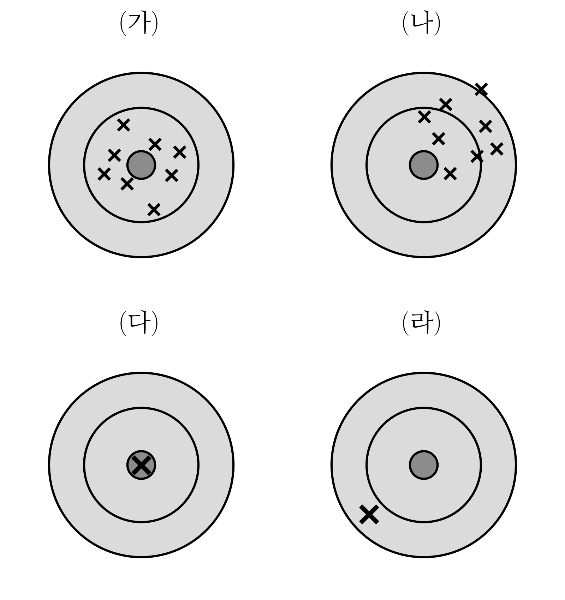{width=70% fig-align="center"}

올바른 것을 모두 고르라.

① 갑의 추정값은 참값 $\theta$ 가 무엇이든 (가) 의 꼴로 찍힌다. \
② 갑의 추정값은 참값 $\theta$ 가 무엇이든 (나) 의 꼴로 찍힌다. \
③ 을의 추정값은 참값 $\theta$ 에 따라 (가) 의 꼴로도, (나) 의 꼴로도 찍힐 수 있다. \
④ 을의 추정값은 참값 $\theta$ 에 따라 (다) 의 꼴로도, (라) 의 꼴로도 찍힐 수 있다. \
⑤ 갑의 추정값은 참값 $\theta$ 에 따라 (가) 의 꼴로도, (나) 의 꼴로도 찍힐 수 있다.

::: {.callout-note collapse="true" title="정답보기(정답률 24% · 보기별 ① 33% · ② 92% · ③ 84% · ④ 82% · ⑤ 35%)"}
**① · ④**
:::

### 문제10

앞면이 나올 확률이 $\theta$ 인 동전을 던져 앞면을 $1$, 뒷면을 $0$ 으로 적는다. ($X_1,\dots,X_n \overset{i.i.d.}{\sim} Ber(\theta)$) 다음 물음에 답하라.

`(1)` 다섯 번 던져 $1,\ 0,\ 0,\ 1,\ 0$ 을 얻었다. 가능도함수 $L(\theta)$ 의 그래프로 알맞은 것을 고르라.

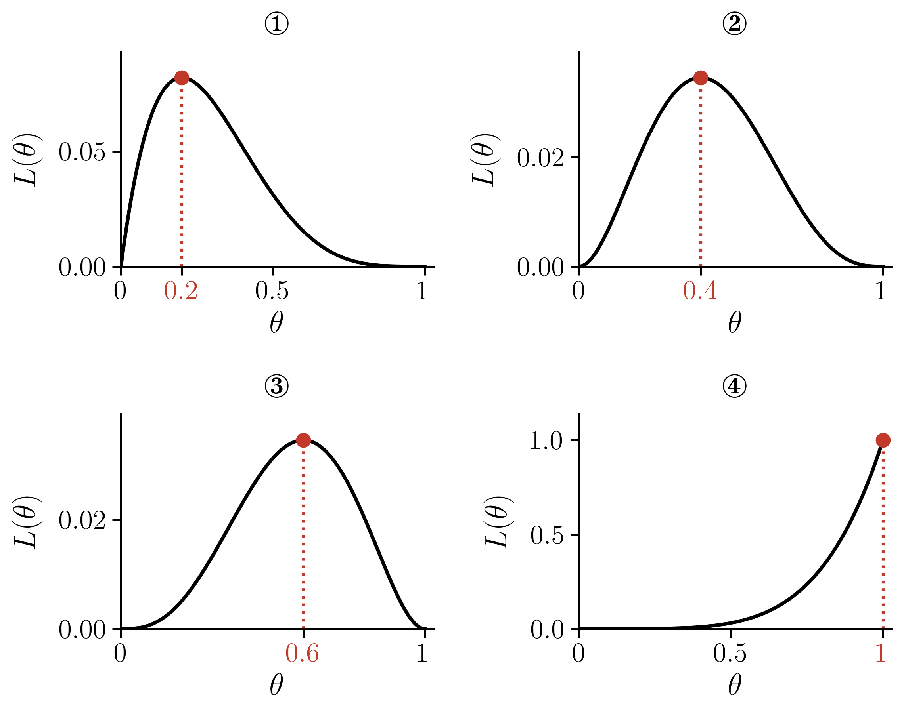{width=85% fig-align="center"}

::: {.callout-note collapse="true" title="정답보기(정답률 92% · 보기별 ① 98% · ② 92% · ③ 94% · ④ 100%)"}
**②**
:::

`(2)` 네 번 던져 $0,\ 1,\ 0,\ 0$ 을 얻었다. 두 학생이 가능도 $L(\theta)$ 를 계산하여 아래 표 (가), (나) 를 만들었다. 바르게 계산한 표를 고르라.

(가)

| $\theta$ | $0$ | $\frac{1}{4}$ | $\frac{2}{4}$ | $\frac{3}{4}$ | $1$ |
|:--:|:--:|:--:|:--:|:--:|:--:|
| $L(\theta)$ | $0$ | $\left(\frac{1}{4}\right)\left(\frac{3}{4}\right)^3\approx0.1055$ | $\left(\frac{2}{4}\right)^4=0.0625$ | $\left(\frac{3}{4}\right)\left(\frac{1}{4}\right)^3\approx0.0117$ | $0$ |

(나)

| $\theta$ | $0$ | $\frac{1}{4}$ | $\frac{2}{4}$ | $\frac{3}{4}$ | $1$ |
|:--:|:--:|:--:|:--:|:--:|:--:|
| $L(\theta)$ | $0$ | $\left(\frac{1}{4}\right)^3\left(\frac{3}{4}\right)\approx0.0117$ | $\left(\frac{2}{4}\right)^4=0.0625$ | $\left(\frac{3}{4}\right)^3\left(\frac{1}{4}\right)\approx0.1055$ | $0$ |

::: {.callout-note collapse="true" title="정답보기(정답률 96%)"}
**(가)**
:::

`(3)` 네 번 던진 기록으로 그린 가능도함수 $L(\theta)$ 가 아래와 같았다. 이 기록으로 알맞은 것을 고르라.

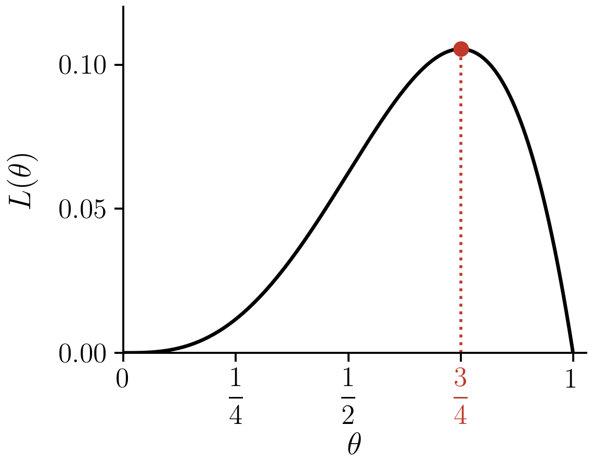{width=55% fig-align="center"}

① $1,\ 0,\ 1,\ 1$ \
② $0,\ 1,\ 0,\ 0$ \
③ $1,\ 1,\ 1,\ 1$ \
④ $1,\ 1,\ 0,\ 0$

::: {.callout-note collapse="true" title="정답보기(정답률 94% · 보기별 ① 94% · ② 98% · ③ 98% · ④ 98%)"}
**①**
:::

`(4)` 세 번 던져 $1,\ 0,\ 1$ 을 얻었다. $\theta$ 의 최대가능도추정값을 구하라.

::: {.callout-note collapse="true" title="정답보기(정답률 86%)"}
**$\frac{2}{3}$**
:::

`(5)` (4) 에서 다음을 최대가능도방법으로 추정하라. (모분산은 $\theta(1-\theta)$ 이고, $1$ 이 처음 나올 때까지 던지는 횟수의 기댓값은 $\frac{1}{\theta}$ 이다.)

- (가) 뒷면이 나올 확률
- (나) 모분산
- (다) $1$ 이 처음 나올 때까지 던지는 횟수의 기댓값

::: {.callout-note collapse="true" title="정답보기(정답률 71% · 보기별 (가) 84% · (나) 84% · (다) 73%)"}
**(가) $\frac{1}{3}$ · (나) $\frac{2}{9}$ · (다) $\frac{3}{2}$**
:::

`(6)` 어떤 기록으로 구한 가능도함수가 $L(\theta)=\theta^2(1-\theta)^4$ 이었다. 이 가능도함수를 나오게 할 만한 기록을 모두 고르라.

① $1,\ 1,\ 0,\ 0,\ 0,\ 0$ \
② $0,\ 1,\ 0,\ 0,\ 1,\ 0$ \
③ $1,\ 1,\ 1,\ 1,\ 0,\ 0$ \
④ $1,\ 0,\ 1,\ 0$

::: {.callout-note collapse="true" title="정답보기(정답률 80% · 보기별 ① 98% · ② 88% · ③ 92% · ④ 100%)"}
**① · ②**
:::

`(7)` 세 번 던져 $x_1,\ x_2,\ x_3$ 을 얻었다. 그런데 $x_1,\ x_2,\ x_3$ 은 알려 주지 않고 그 평균 $\bar{x}=\frac{x_1+x_2+x_3}{3}$ 만 알려 주었다. $L(0.5\mid\bar{x}=\frac{2}{3})$ 과 $L(0.5\mid\bar{x}=\frac{1}{2})$ 를 구하라.

::: {.callout-note collapse="true" title="정답보기(정답률 37% · 보기별 L(0.5|x̄ 45% · L(0.5|x̄ 65%)"}
**$\frac{3}{8}$, $0$**
:::

`(8)` (1) 에서 다섯 번 던져 $1,\ 0,\ 0,\ 1,\ 0$ 을 얻은 뒤 한 번 더 던졌다. 이를 두고 나눈 대화에서 올바른 것을 모두 고르라.

① 재석: "여섯째가 $1$ 이면 $\theta$ 의 최대가능도추정값은 $0.4$ 에서 $\frac{1}{2}$ 로 커져." \
② 동엽: "여섯째가 $0$ 이면 최대가능도추정값은 $0.4$ 그대로야." \
③ 호동: "여섯째가 무엇이든, 새 가능도함수는 $\theta^2(1-\theta)^3$ 에 $\theta$ 나 $1-\theta$ 가 하나 곱해진 꼴이야."

::: {.callout-note collapse="true" title="정답보기(정답률 76% · 보기별 ① 94% · ② 94% · ③ 88%)"}
**① · ③**
:::

### 문제11

정규분포 모형의 가능도함수와 최대가능도추정에 대하여 답하라. ($X\sim N(\mu,\sigma^2)$ 이면 $\mathbb{E}(X^2)=\mu^2+\sigma^2$ 이다.)

`(1)` $X_1,\dots,X_{10} \overset{i.i.d.}{\sim} N(\mu,1)$ 에서 아래 $10$ 개를 관측하였다. ($\sigma^2=1$ 은 알려져 있다.)

$$0,\ 0,\ 1,\ 1,\ 1,\ 2,\ 3,\ 3,\ 4,\ 5$$

$\mu$ 에 대한 가능도함수 $L(\mu)$ 의 그래프로 알맞은 것을 고르라.

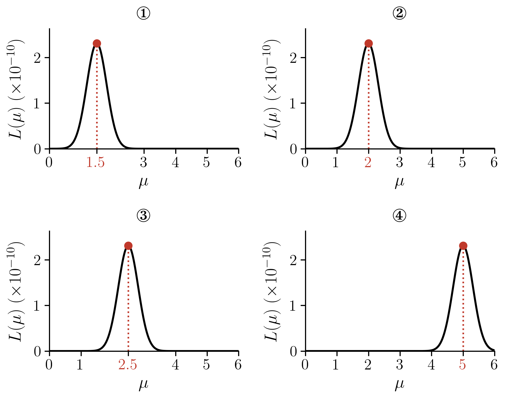{width=85% fig-align="center"}

::: {.callout-note collapse="true" title="정답보기(정답률 94% · 보기별 ① 98% · ② 94% · ③ 98% · ④ 98%)"}
**②**
:::

`(2)` (1) 과 같은 관측값 $10$ 개를, 이번에는 $\sigma^2$ 도 모른다고 보고 $X_1,\dots,X_{10} \overset{i.i.d.}{\sim} N(\mu,\sigma^2)$ 의 관측값으로 보자. (이 $10$ 개에서 편차 제곱의 합을 $n=10$ 으로 나눈 값은 $\frac{1}{10}\sum_{i=1}^{10}(x_i-\bar{x})^2=2.6$ 이고, $n-1=9$ 로 나눈 값은 $\frac{1}{9}\sum_{i=1}^{10}(x_i-\bar{x})^2\approx2.89$ 이다.) 가능도함수 $L(\mu,\sigma^2)$ 의 그래프로 알맞은 것을 고르라. (빨간 점이 가장 큰 곳이고, 그 좌표를 적어 두었다.)

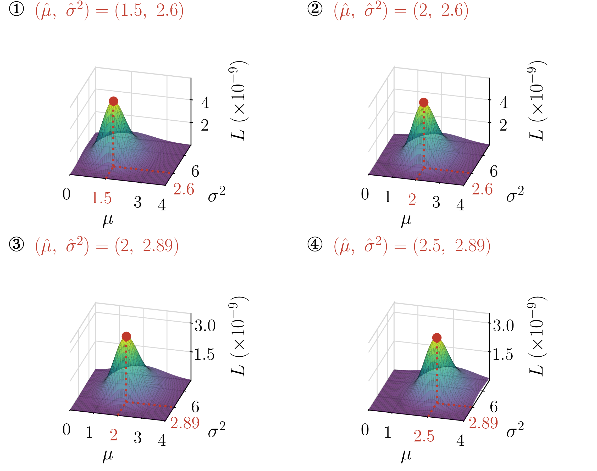{width=90% fig-align="center"}

::: {.callout-note collapse="true" title="정답보기(정답률 84% · 보기별 ① 98% · ② 84% · ③ 94% · ④ 92%)"}
**②**
:::

`(3)` $X_1,\dots,X_4 \overset{i.i.d.}{\sim} N(\mu,\sigma^2)$ 의 관측값 $4$ 개로 그린 가능도함수 $L(\mu,\sigma^2)$ 가 아래와 같았다. 이 관측값으로 알맞은 것을 고르라.

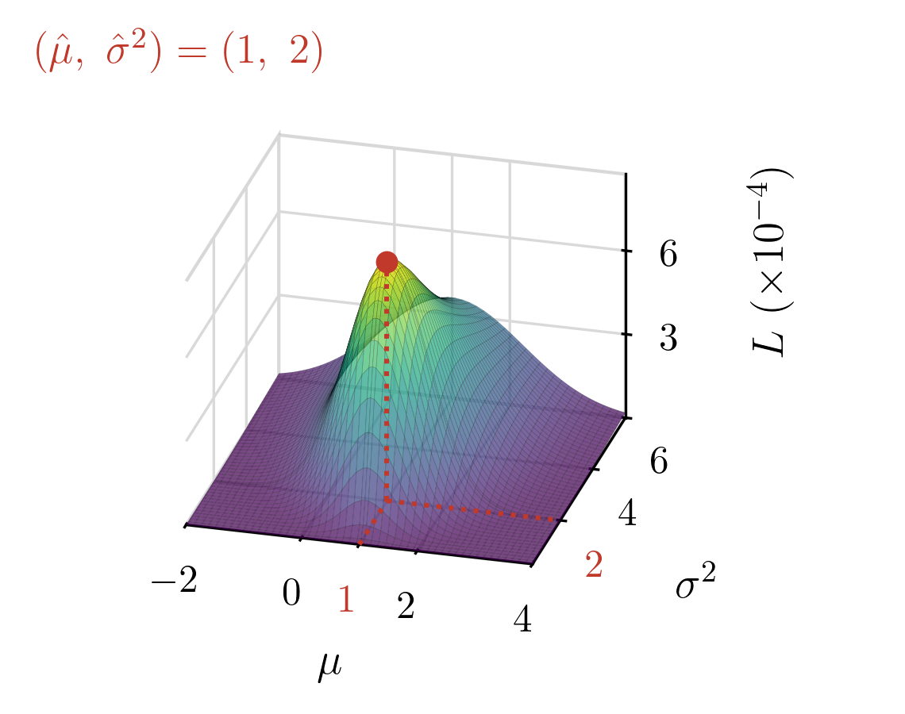{width=60% fig-align="center"}

① $-1,\ 1,\ 1,\ 3$ \
② $0,\ 1,\ 1,\ 2$ \
③ $0,\ 2,\ 2,\ 4$ \
④ $-2,\ 0,\ 0,\ 2$

::: {.callout-note collapse="true" title="정답보기(정답률 75% · 보기별 ① 80% · ② 80% · ③ 96% · ④ 100%)"}
**①**
:::

`(4)` $X_1,\dots,X_4 \overset{i.i.d.}{\sim} N(\mu,\sigma^2)$ 에서 $1,\ 3,\ 5,\ 7$ 을 관측하였다. $\mu$ 와 $\sigma^2$ 의 최대가능도추정값을 구하라. (네 값의 제곱의 평균은 $\frac{1}{4}\sum_{i=1}^{4}x_i^2=21$ 이다.)

::: {.callout-note collapse="true" title="정답보기(정답률 67% · 보기별 μ̂ 82% · σ̂² 71%)"}
**$\hat{\mu}=4$, $\hat{\sigma}^2=5$**
:::

`(5)` (4) 와 같은 관측값 $1,\ 3,\ 5,\ 7$ 에서, 이번에는 $\sigma^2=1$ 임을 알고 있다고 하자. $\mathbb{E}(X^2)$ 을 최대가능도방법으로 추정하라.

::: {.callout-note collapse="true" title="정답보기(정답률 65%)"}
**$17$**
:::

`(6)` $X_1,X_2,X_3 \overset{i.i.d.}{\sim} N(\mu,1)$ 의 관측값으로 구한 가능도함수가 아래와 같았다. $\mu$ 의 최대가능도추정값을 구하라.

$$L(\mu) = \left(\frac{1}{\sqrt{2\pi}}\right)^3\exp\left[-\frac{(\mu-2.1)^2 + (\mu-3.5)^2 + (\mu-4.3)^2}{2}\right]$$

::: {.callout-note collapse="true" title="정답보기(정답률 69%)"}
**$3.3$**
:::

`(7)` (6) 의 가능도함수를 나오게 할 만한 관측값을 모두 고르라.

① $2.1,\ 3.5,\ 4.3$ \
② $4.3,\ 2.1,\ 3.5$ \
③ $3.3,\ 3.3,\ 3.3$ \
④ $2.1,\ 3.5$

::: {.callout-note collapse="true" title="정답보기(정답률 61% · 보기별 ① 94% · ② 82% · ③ 80% · ④ 100%)"}
**① · ②**
:::

`(8)` (4) 의 자료 $1,\ 3,\ 5,\ 7$ 에 관측값을 하나 더 얻었다. 이를 두고 나눈 대화에서 올바른 것을 모두 고르라.

① 재석: "새 관측값이 $4$ 이면 $\hat{\mu}$ 는 $4$ 그대로야." \
② 동엽: "새 관측값이 $4$ 이면 $\hat{\sigma}^2$ 도 $5$ 그대로야." \
③ 호동: "새 관측값이 $9$ 이면 $\hat{\mu}$ 는 $5$ 가 돼." \
④ 효리: "새 관측값이 무엇이든 $\hat{\mu}$ 는 $4$ 그대로야. 하나쯤 더해도 평균은 바뀌지 않거든."

::: {.callout-note collapse="true" title="정답보기(정답률 73% · 보기별 ① 88% · ② 88% · ③ 90% · ④ 100%)"}
**① · ③**
:::

### 문제12

$X_1,\dots,X_4 \overset{i.i.d.}{\sim} N(\mu,\sigma^2)$ 에서 $1,\ 1,\ 5,\ 5$ 를 관측하였다. 갑과 을은 $\mu$ 를 $\bar{x}=3$ 으로 추정한 뒤, $\sigma^2$ 을 아래와 같이 추정하였다.

- 갑: $\frac{1}{4}\sum_{i=1}^{4}(x_i-\bar{x})^2=4$
- 을: $\frac{1}{3}\sum_{i=1}^{4}(x_i-\bar{x})^2=\frac{16}{3}$

올바른 것을 모두 고르라.

① 가능도 $L(\mu,\sigma^2)$ 의 값은 $(\mu,\sigma^2)=(3,\ 4)$ 에서가 $\left(3,\ \frac{16}{3}\right)$ 에서보다 크다. \
② 두 사람 가운데 $\sigma^2$ 의 최대가능도추정값을 구한 사람은 을이다. \
③ $\mu=3$ 임을 미리 알고 있었다면, $\sigma^2$ 의 최대가능도추정값은 을의 값 $\frac{16}{3}$ 이다.

::: {.callout-note collapse="true" title="정답보기(정답률 65% · 보기별 ① 76% · ② 84% · ③ 73%)"}
**①**
:::

### 문제13

다음 글을 읽고 물음에 답하라.

::: {.passage}
명제 $P$ 가 참이면 $1$, 거짓이면 $0$ 인 함수 $I(P)$ 를 지시함수라 한다. 균등분포 $U(a,b)$ 의 확률밀도함수는 지시함수로 $f(x)=\frac{1}{b-a}I(a \leq x \leq b)$ 라 쓸 수 있다. 그래서 $X_1,\dots,X_5 \overset{i.i.d.}{\sim} U(a,b)$ 에서 아래 자료를 얻었다.

$$x_1=1.3,\quad x_2=0.8,\quad x_3=2.6,\quad x_4=1.9,\quad x_5=2.2$$

한 학생은 이 자료의 가능도함수를 아래와 같이 구하였다.

$$
\begin{aligned}
L(a,b) &= \frac{1}{b-a}I(a \leq x_1 \leq b) \times \cdots \times \frac{1}{b-a}I(a \leq x_5 \leq b) \\
&= \frac{1}{(b-a)^5}\, I(a \leq x_1 \leq b) \cdots I(a \leq x_5 \leq b) \\
&= \frac{1}{(b-a)^5}\, I\big(a \leq \min(x_1,\dots,x_5)\big)\, I\big(\max(x_1,\dots,x_5) \leq b\big) \\
&= \frac{1}{(b-a)^5}\, I(a \leq 0.8)\, I(2.6 \leq b)
\end{aligned}
$$
:::

`(1)` 윗글의 자료에서 $a$, $b$ 의 최대가능도추정값을 구하고, 모평균 $\mathbb{E}(X)$, 모분산 $\mathbb{V}(X)$, 범위 $R(X)$ 를 최대가능도방법으로 추정하라. ($X\sim U(a,b)$ 이면 $\mathbb{E}(X)=\frac{a+b}{2}$, $\mathbb{V}(X)=\frac{(b-a)^2}{12}$, $R(X)=b-a$ 이다.)

::: {.callout-note collapse="true" title="정답보기(정답률 43% · 보기별 â 57% · b̂ 63% · E(X) 76% · V(X) 71% · R(X) 76%)"}
**$\hat{a}=0.8$, $\hat{b}=2.6$, 모평균 $1.7$, 모분산 $\frac{1.8^2}{12}=0.27$, 범위 $1.8$**
:::

`(2)` 윗글의 자료에 관측값을 하나 더 얻어 관측값이 여섯 개가 되었다고 하자. 이를 두고 나눈 대화에서 올바른 것을 모두 고르라.

① 재석: "새 관측값이 $1.5$ 라면, 가능도를 가장 크게 하는 $(a,b)$ 는 $(0.8,\ 2.6)$ 그대로야." \
② 동엽: "새 관측값이 $1.5$ 라면, 가능도함수도 처음과 똑같아." \
③ 호동: "새 관측값이 $3.0$ 이라면, 가능도를 가장 크게 하는 $b$ 는 $3.0$ 이 돼." \
④ 효리: "새 관측값이 $0.5$ 라면, $(a,b)=(0.8,\ 2.6)$ 에서 가능도는 $0$ 이야."

::: {.callout-note collapse="true" title="정답보기(정답률 33% · 보기별 ① 96% · ② 57% · ③ 92% · ④ 61%)"}
**① · ③ · ④**
:::

`(3)` $X_1,X_2,X_3 \overset{i.i.d.}{\sim} U(a,b)$ 에서 아래 자료를 얻었다.

$$x_1=1.2,\quad x_2=1.5,\quad x_3=1.8$$

가능도함수 $L(a,b)$ 의 값을 몇 점에서 계산한 표로 알맞은 것을 고르라.

①

| | $b=1.7$ | $b=1.8$ | $b=1.9$ |
|:--:|:--:|:--:|:--:|
| $a=1.1$ | $0$ | $0$ | $0$ |
| $a=1.2$ | $\frac{1}{(1.7-1.2)^3}$ | $\frac{1}{(1.8-1.2)^3}$ | $0$ |
| $a=1.3$ | $\frac{1}{(1.7-1.3)^3}$ | $\frac{1}{(1.8-1.3)^3}$ | $0$ |

②

| | $b=1.7$ | $b=1.8$ | $b=1.9$ |
|:--:|:--:|:--:|:--:|
| $a=1.1$ | $0$ | $\frac{1}{(1.8-1.1)^3}$ | $\frac{1}{(1.9-1.1)^3}$ |
| $a=1.2$ | $0$ | $\frac{1}{(1.8-1.2)^3}$ | $\frac{1}{(1.9-1.2)^3}$ |
| $a=1.3$ | $0$ | $0$ | $0$ |

::: {.callout-note collapse="true" title="정답보기(정답률 65%)"}
**②**
:::

`(4)` $X_1,\dots,X_4 \overset{i.i.d.}{\sim} U(a,b)$ 에서 아래 자료를 관측하였다.

$$x_1=0.6,\quad x_2=1.3,\quad x_3=1.0,\quad x_4=1.7$$

가능도함수 $L(a,b)$ 의 그래프로 알맞은 것을 고르라.

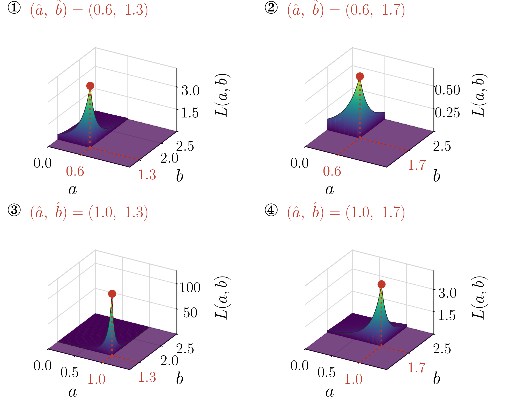{width=90% fig-align="center"}

::: {.callout-note collapse="true" title="정답보기(정답률 94% · 보기별 ① 96% · ② 94% · ③ 98% · ④ 96%)"}
**②**
:::

`(5)` $X_1,\dots,X_4 \overset{i.i.d.}{\sim} U(a,b)$ 의 네 관측값으로 그린 가능도함수 $L(a,b)$ 가 아래와 같았다. 이 관측값으로 알맞은 것을 고르라.

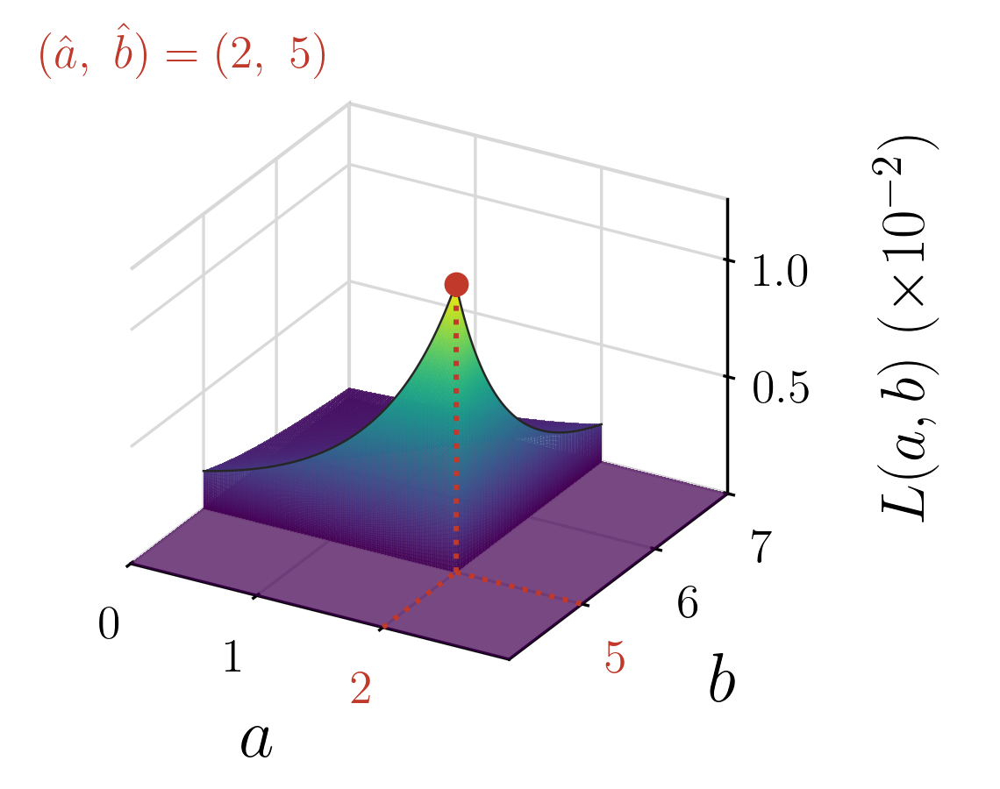{width=60% fig-align="center"}

① $2,\ 4,\ 4,\ 5$ \
② $2,\ 3,\ 4,\ 6$ \
③ $3,\ 4,\ 5,\ 5$ \
④ $1,\ 2,\ 3,\ 5$

::: {.callout-note collapse="true" title="정답보기(정답률 90%)"}
**①**
:::

`(6)` 어떤 자료로 구한 가능도함수가 $L(a,b)=\frac{1}{(b-a)^3}\,I(a\leq1.2)\,I(2.5\leq b)$ 이었다. 이 가능도함수를 나오게 할 만한 자료를 모두 고르라.

① $1.2,\ 1.8,\ 2.5$ \
② $2.5,\ 1.2,\ 2.0$ \
③ $1.2,\ 2.5$ \
④ $1.2,\ 1.8,\ 2.4,\ 2.5$

::: {.callout-note collapse="true" title="정답보기(정답률 73% · 보기별 ① 98% · ② 90% · ③ 80% · ④ 78%)"}
**① · ②**
:::

`(7)` $X \sim U(0,\theta)$ 에서 아래 $4$ 개의 표본을 얻었다.

$$x_1=0.3,\quad x_2=0.1,\quad x_3=0.7,\quad x_4=0.5$$

$\theta$ 의 최대가능도추정값을 구하고, 모평균을 최대가능도방법으로 추정하라. ($X\sim U(0,\theta)$ 이면 $\mathbb{E}(X)=\frac{\theta}{2}$ 이다.)

::: {.callout-note collapse="true" title="정답보기(정답률 75%)"}
**$0.7$, $0.35$**
:::

### 문제14

평면 위의 점 $(x_i,y_i)$, $i=1,\dots,100$ 을 관측하여 점들의 중심을 추정하는 두 방법이 있다.

- A: $\left(\frac{\min_i x_i+\max_i x_i}{2},\ \frac{\min_i y_i+\max_i y_i}{2}\right)$ 로 추정한다.
- B: $(\bar{x},\ \bar{y})$ 로 추정한다.

$x_i$, $y_i$ 가 모두 서로 독립으로 $U(0,1)$ 을 따르는 자료 $100$ 개를 만들어 추정하는 일을 $2000$ 번 되풀이하고, 추정값을 과녁에 찍었다. 과녁의 중심($+$)이 참값이다. 아래 (가), (나) 가운데 하나는 A 로, 다른 하나는 B 로 찍은 것이다.

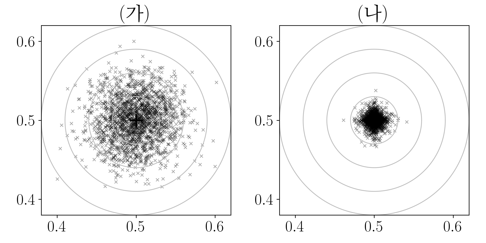{width=80% fig-align="center"}

(가), (나) 가운데 A 로 찍은 것을 고르라.

::: {.callout-note collapse="true" title="정답보기(정답률 90%)"}
**(나)**
:::

### 문제15

다음 설명이 옳으면 O, 틀리면 X 를 쓰라.

- (가) $X_1,\dots,X_n \overset{i.i.d.}{\sim} N(\mu,\sigma^2)$ 이면, 평균 $\mu$ 의 최대가능도추정값은 표본평균 $\bar{x}$ 이다.
- (나) $X_1,\dots,X_n \overset{i.i.d.}{\sim} U(a,b)$ 이면, 평균 $\frac{a+b}{2}$ 의 최대가능도추정값은 표본평균 $\bar{x}$ 이다.
- (다) 자료가 정규분포에서 나왔다면, 평균을 표본평균으로 추정한 값은 중앙값으로 추정한 값보다 참값 둘레에 좁게 모인다.
- (라) 표본평균은 자료를 모두 쓰므로, 자료가 어떤 분포에서 나왔든 평균을 추정하는 다른 어떤 방법보다 참값 둘레에 좁게 모인다.

::: {.callout-note collapse="true" title="정답보기(정답률 63% · 보기별 (가) 98% · (나) 73% · (다) 84% · (라) 90%)"}
**(가) O · (나) X · (다) O · (라) X**
:::

### 문제16

바늘이 하나 있는 시계에서 바늘을 무작위로 돌린다. 바늘의 위치를 각도로 나타내면 $\Omega=[0,2\pi)$ 이고, 바늘이 $\Omega$ 의 부분집합 $\Omega^*$ 에 멈출 확률을 $P(\Omega^*) = \frac{m(\Omega^*)}{2\pi}$ 로 정한다. 확률은 이렇게 $\Omega$ 의 부분집합에만 매기고, $\Omega$ 를 벗어나는 집합에는 매기지 않는다. 길이 $m$ 은 아래와 같이 약속하고, 집합을 평행이동해도 길이는 변하지 않는다고 하자.

- 약속1: 구간 $(a,b)$ 의 길이는 $b-a$ 이다.
- 약속2: 한 점의 길이는 $0$ 이다.
- 약속3: 점을 무한히 합치면 선이 되는 것처럼, 점의 길이를 무한히 합치면 $0$ 이 아니라 $0$ 보다 큰 어떠한 수가 된다.
- 약속4: 구간 $(a,b)$ 사이의 모든 유리수의 길이는 $\frac{b-a}{2}$ 이다.

이렇게 길이를 재면 확률을 정의할 때 모순이 생긴다. 다음은 그것을 보인 풀이이다.

::: {.passage}
$A$ 를 $(0,\pi)$ 사이의 모든 유리수로 이루어진 집합이라 하자. 약속4에 의해 $m(A)=\frac{\pi}{2}$ 이므로 $P(A)=\frac{\pi/2}{2\pi}=\frac{1}{4}$ 이다. $A$ 의 모든 점에 $\sqrt{2}$, $\frac{\sqrt{2}}{2}$, $\frac{\sqrt{2}}{3}$, $\frac{\sqrt{2}}{4}$ 를 더하여 만든 집합을 각각 $A_{\sqrt{2}}$, $A_{\sqrt{2}/2}$, $A_{\sqrt{2}/3}$, $A_{\sqrt{2}/4}$ 라 하자. 평행이동해도 길이는 변하지 않으므로 이 네 집합의 확률도 저마다 $\frac{1}{4}$ 이다. 또 $A$ 까지 다섯 집합은 모두 $\Omega$ 의 부분집합이고 서로 겹치지 않는다. 따라서

$$P(A\cup A_{\sqrt{2}}\cup A_{\sqrt{2}/2}\cup A_{\sqrt{2}/3}\cup A_{\sqrt{2}/4}) = 5\times\frac{1}{4}=\frac{5}{4}>1$$

이 되어 확률의 공리에 어긋난다.
:::

이번에는 윗글의 $A$ 의 원소에 $\frac{2\pi}{k}$ 를 더해 만든 집합을 $A_{2\pi/k}$ 라 하자. ($k=1,2,3,\dots$)

`(1)` 다음 가운데 $\Omega$ 의 부분집합인 것을 모두 고르라.

① $A_{2\pi}$ \
② $A_{2\pi/2}$ \
③ $A_{2\pi/3}$ \
④ $A_{2\pi/4}$

::: {.callout-note collapse="true" title="정답보기(정답률 39% · 보기별 ① 59% · ② 80% · ③ 84% · ④ 84%)"}
**② · ③ · ④**
:::

`(2)` 올바른 것을 모두 고르라.

① $P(A_{2\pi})$ 는 정할 수 없다. 약속1~4 로 길이를 재는 방법은 $\Omega$ 의 부분집합에서만 유효하기 때문이다. \
② $A, A_{2\pi/2}, A_{2\pi/3}, A_{2\pi/4}$ 는 서로 겹치지 않고, 각각의 확률은 $\frac{1}{4}$ 이다. \
③ $A, A_{2\pi}, A_{2\pi/2}, A_{2\pi/3}, A_{2\pi/4}$ 의 확률을 모두 더하면 $\frac{5}{4}$ 이므로, 이 다섯 집합으로 모순을 얻는다. \
④ $A_{2\pi}$ 대신 $A_{2\pi/5}$ 를 쓰면, $A, A_{2\pi/2}, A_{2\pi/3}, A_{2\pi/4}, A_{2\pi/5}$ 다섯 집합으로 모순을 얻을 수 있다.

::: {.callout-note collapse="true" title="정답보기(정답률 20% · 보기별 ① 65% · ② 61% · ③ 49% · ④ 67%)"}
**① · ② · ④**
:::

`(3)` 윗글의 풀이에서는 다섯 집합 $A, A_{\sqrt{2}}, A_{\sqrt{2}/2}, A_{\sqrt{2}/3}, A_{\sqrt{2}/4}$ 로 모순을 얻었다. 그런데 $\frac{2\pi}{k}$ 를 더해 만든 다섯 집합 $A, A_{2\pi}, A_{2\pi/2}, A_{2\pi/3}, A_{2\pi/4}$ 로는 같은 방법으로 모순을 얻을 수 없다. 그 까닭으로 올바른 것을 모두 고르라.

① $A_{2\pi}$ 이 $\Omega$ 를 벗어나기 때문이다. \
② $2\pi$ 가 유리수이기 때문이다. \
③ 확률은 $\Omega$ 의 부분집합에만 매기기로 했기 때문이다.

::: {.callout-note collapse="true" title="정답보기(정답률 51% · 보기별 ① 69% · ② 69% · ③ 82%)"}
**① · ③**
:::

### 문제17

`(1)` 다음 명제가 참이면 O, 거짓이면 X 를 쓰라. ($\mathbb{N}=\{1,2,3,\dots\}$ 은 자연수 전체, $\mathbb{R}$ 은 실수 전체의 집합이다.)

- (가) $\forall n\in\mathbb{N}:\ n+1\in\mathbb{N}$
- (나) $\exists n\in\mathbb{N}$ such that $n+1=1$
- (다) $\forall x\in\mathbb{R}\ \ \exists y\in\mathbb{R}$ such that $x+y=0$
- (라) $\exists y\in\mathbb{R}$ such that $\forall x\in\mathbb{R}:\ x+y=0$

::: {.callout-note collapse="true" title="정답보기(정답률 12% · 보기별 (가) 90% · (나) 88% · (다) 84% · (라) 20%)"}
**(가) O · (나) X · (다) O · (라) X**
:::

`(2)` 함수 $f:X\to Y$ 에 대한 아래 기호 문장 (가), (나) 의 뜻으로 알맞은 것을 ①~④ 에서 각각 고르라.

- (가) $\exists x_1,x_2\in X$ such that $x_1\neq x_2$ and $f(x_1)=f(x_2)$
- (나) $\exists y\in Y$ such that $\forall x\in X:\ f(x)\neq y$

① $f$ 는 단사이다. \
② $f$ 는 전사이다. \
③ $f$ 는 단사가 아니다. \
④ $f$ 는 전사가 아니다.

(답은 ‘(가) ②, (나) ①’ 과 같은 꼴로 쓴다.)

::: {.callout-note collapse="true" title="정답보기(정답률 63% · 보기별 (가) 67% · (나) 75%)"}
**(가) ③, (나) ④**
:::

`(3)` “모든 자연수 $n$ 에 대하여, $n^2$ 은 $n$ 이상이다” 를 기호로 바르게 쓴 것을 모두 고르라.

① $\forall n\in\mathbb{N}:\ n^2\geq n$ \
② $n^2\geq n,\ \forall n\in\mathbb{N}$ \
③ $\exists n\in\mathbb{N}$ such that $n^2\geq n$ \
④ $n\in\mathbb{N}\Rightarrow n^2\geq n$

::: {.callout-note collapse="true" title="정답보기(정답률 27% · 보기별 ① 96% · ② 76% · ③ 65% · ④ 69%)"}
**① · ② · ④**
:::

### 문제18

아래 (가)~(라) 는 모두 같은 규칙 $f(x)=x^2$ 으로 집합 $X$ 의 원소를 집합 $Y$ 의 원소로 보내는 함수를 화살표로 나타낸 것이다. 네 그림에서 다른 것은 $X$ 와 $Y$ 뿐이다. 왼쪽 타원이 $X$, 오른쪽 타원이 $Y$ 이다.

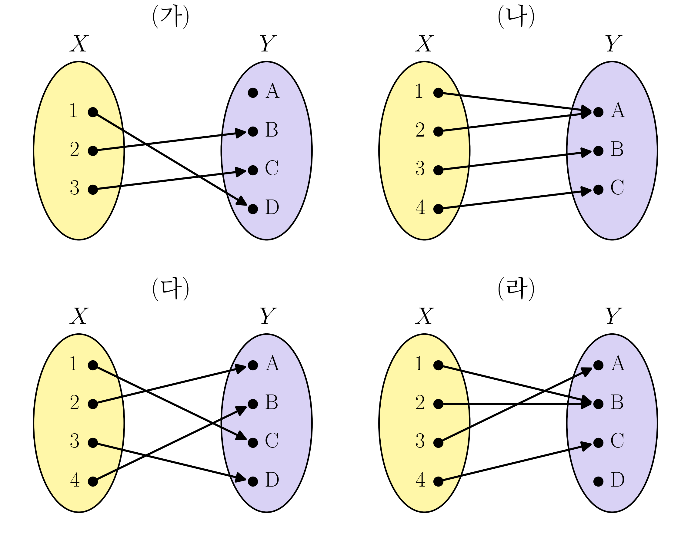{width=90% fig-align="center"}

`(1)` 단사함수인 것을 모두 고르라.

::: {.callout-note collapse="true" title="정답보기(정답률 78% · 보기별 (가) 98% · (나) 84% · (다) 94% · (라) 98%)"}
**(나) · (다)**
:::

`(2)` 전사함수인 것을 모두 고르라.

::: {.callout-note collapse="true" title="정답보기(정답률 76% · 보기별 (가) 94% · (나) 84% · (다) 94% · (라) 96%)"}
**(가) · (나)**
:::

`(3)` 전단사함수인 것을 모두 고르라.

::: {.callout-note collapse="true" title="정답보기(정답률 86% · 보기별 (가) 94% · (나) 92% · (다) 90% · (라) 98%)"}
**(나)**
:::

### 문제19

다음 명제가 참이면 증명하고, 거짓이면 반례를 들어라.

> 실수의 두 구간 $A=[a,b]$, $B=[c,d]$ (단, $a<b$, $c<d$) 에 대하여, $A$ 의 길이 $b-a$ 가 $B$ 의 길이 $d-c$ 보다 길면 $|A|>|B|$ 이다.

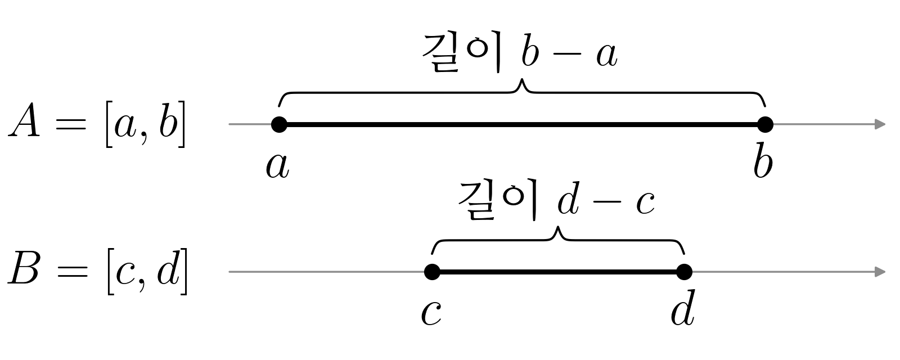{width=55% fig-align="center"}

::: {.callout-note collapse="true" title="정답보기(정답률 12%)"}
**거짓 — 반례: $A=[0,2]$, $B=[0,1]$** ($f(x)=2x$ 가 $B$ 에서 $A$ 로 가는 전단사함수이므로 $|A|=|B|$)
:::

### 문제20

다음 물음에 답하라.

`(1)` 아래 세 수열 각각에 대하여, 그 수열의 값들로 이루어진 집합을 생각하자. 그 집합의 카디널리티가 $|\mathbb{N}|$ 과 같은 것을 모두 고르라.

① $1,\ \frac{1}{2},\ \frac{1}{3},\ \frac{1}{4},\ \dots$ \
② $0,\ \frac{1}{2},\ \frac{2}{2},\ \frac{1}{3},\ \frac{2}{3},\ \frac{3}{3},\ \frac{1}{4},\ \dots$ \
③ $-44,\ -2,\ 0,\ 1,\ 2,\ 3,\ \dots$

::: {.callout-note collapse="true" title="정답보기(정답률 65% · 보기별 ① 86% · ② 71% · ③ 82%)"}
**① · ② · ③**
:::

`(2)` (1) ② 의 수열을 $a_1,a_2,a_3,\dots$ 라 하고, 그 값들의 집합을 $A$ 라 하자. $\mathbb{N}$ 에서 $A$ 로 가는 함수 $f(n)=a_n$ 에 대하여 올바른 것을 모두 고르라.

① $f$ 는 전사함수이다. \
② $f$ 는 단사함수이다. \
③ $f$ 가 전단사함수가 아니므로, $|A|\neq|\mathbb{N}|$ 이다.

::: {.callout-note collapse="true" title="정답보기(정답률 22% · 보기별 ① 82% · ② 41% · ③ 80%)"}
**①**
:::

### 문제21

좌표평면에서 두 좌표가 모두 정수인 점 전체의 집합을 $L=\{(a,b): a,b\in\mathbb{Z}\}$ 라 하자. ($\mathbb{Z}$ 는 정수 전체의 집합) 아래 그림의 (가), (나) 는 $L$ 의 점을 한 걸음에 하나씩 차례로 밟아 가는 두 길이다. $n$ 번째 걸음에 밟는 점을 $g(n)$ 이라 하면, $g$ 는 $\mathbb{N}=\{1,2,3,\dots\}$ 에서 $L$ 로 가는 함수이다. ($g(1)$ 은 원점) 다음 물음에 답하라.

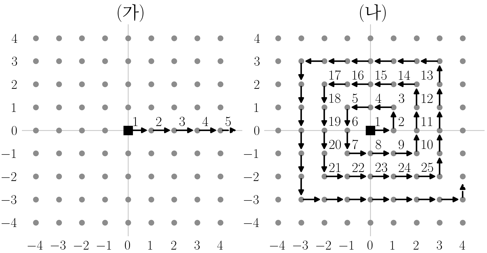{width=95% fig-align="center"}

`(1)` 올바른 것을 모두 고르라.

① (가) 의 $g$ 는 단사함수이지만 전사함수는 아니다. \
② (가) 의 $g$ 가 전사함수가 아니므로, $|\mathbb{N}|<|L|$ 이다. \
③ (나) 의 $g$ 는 전단사함수이므로, $|\mathbb{N}|=|L|$ 이다.

::: {.callout-note collapse="true" title="정답보기(정답률 24% · 보기별 ① 49% · ② 69% · ③ 71%)"}
**① · ③**
:::

`(2)` $L$ 의 점 가운데 두 좌표가 모두 $0$ 이상인 점 전체의 집합을 $L^+$ 라 하자. 올바른 것을 모두 고르라.

① $L^+\subset L$ 이므로 $|L^+|\leq|L|$ 이고, (1) 에서 $|L|=|\mathbb{N}|$ 이므로 $|L^+|\leq|\mathbb{N}|$ 이다. \
② (가) 의 $g$ 의 값은 모두 $L^+$ 에 들어 있으므로, $\mathbb{N}$ 에서 $L^+$ 로 가는 단사함수가 있다. 곧 $|\mathbb{N}|\leq|L^+|$ 이다. \
③ ① 과 ② 를 합치면 $|L^+|=|\mathbb{N}|$ 이다. \
④ $L^+$ 는 $L$ 의 대략 $\frac{1}{4}$ 만 차지하므로, $|L^+|$ 는 $|L|$ 보다 작다.

::: {.callout-note collapse="true" title="정답보기(정답률 39% · 보기별 ① 82% · ② 65% · ③ 47% · ④ 78%)"}
**① · ② · ③**
:::

### 문제22

다음은 $|\mathbb{N}|=|\mathbb{Q}|$ 임을 보인 증명이다. 물음에 답하라.

::: {.passage}
$|\mathbb{N}|=|\mathbb{Q}|$ 임을 보이자. 먼저 양의 유리수 전체의 집합 $\mathbb{Q}^+$ 에 대하여 $|\mathbb{N}|=|\mathbb{Q}^+|$ 임을 보이고, 그다음 $0$ 과 음의 유리수까지 넣어 $\mathbb{Q}$ 전체로 넓힌다. $|\mathbb{N}|=|\mathbb{Q}^+|$ 를 보이려면 $\mathbb{N}$ 에서 $\mathbb{Q}^+$ 로 가는 전단사함수를 찾으면 된다. 아래 그림처럼 분수 $\frac{p}{q}$ 를 $p$ 번째 줄, $q$ 번째 칸에 적고, 화살표를 따라 나오는 분수를 차례로 $a_1,a_2,a_3,\dots$ 라 하자.

| $n$ | $1$ | $2$ | $3$ | $4$ | $5$ | $6$ | $7$ | $8$ | $9$ | $10$ | $11$ | $12$ | $\cdots$ |
|:--:|:--:|:--:|:--:|:--:|:--:|:--:|:--:|:--:|:--:|:--:|:--:|:--:|:--:|
| $a_n$ | $1/1$ | $2/1$ | $1/2$ | $1/3$ | $2/2$ | $3/1$ | $4/1$ | $3/2$ | $2/3$ | $1/4$ | $1/5$ | $2/4$ | $\cdots$ |

<!-- colwidths: 4.4 2.4 2.4 2.4 2.4 2.4 2.4 2.4 2.4 2.4 2.4 2.4 2.4 2.4 -->

그러면 [㉠ 모든 양의 유리수는 이 수열 어딘가에 반드시 나온다]{.underline}. 다만 $a_5=\frac{2}{2}=a_1$, $a_{12}=\frac{2}{4}=a_3$ 처럼 이미 나온 수(그림의 빨간 분수)가 다시 나오기도 한다. 그래서 [㉡ 처음 나오는 항의 번호만 골라 차례로 $b_1,b_2,b_3,\dots$ 라 한다]{.underline}.

| $n$ | $1$ | $2$ | $3$ | $4$ | $5$ | $6$ | $7$ | $8$ | $9$ | $10$ | $\cdots$ |
|:--:|:--:|:--:|:--:|:--:|:--:|:--:|:--:|:--:|:--:|:--:|:--:|
| $b_n$ | $1$ | $2$ | $3$ | $4$ | $6$ | $7$ | $8$ | $9$ | $10$ | $11$ | $\cdots$ |
| $a(b_n)$ | $1/1$ | $2/1$ | $1/2$ | $1/3$ | $3/1$ | $4/1$ | $3/2$ | $2/3$ | $1/4$ | $1/5$ | $\cdots$ |

<!-- colwidths: 4.4 2.4 2.4 2.4 2.4 2.4 2.4 2.4 2.4 2.4 2.4 2.4 -->

그러면 $f(n)=a(b_n)$ 은 $\mathbb{N}$ 에서 $\mathbb{Q}^+$ 로 가는 전단사함수이므로 $|\mathbb{N}|=|\mathbb{Q}^+|$ 이다. 이제 $a(b_n)$ 을 $q_n$ 이라 쓰자($q_1=1$, $q_2=2$, $q_3=\frac{1}{2}$, $\dots$). 음의 유리수는 $-q_1,-q_2,-q_3,\dots$ 이다. $\mathbb{Q}$ 의 수를 (가) 와 같이 늘어놓고 자연수 $1,2,3,\dots$ 와 차례로 짝지으면 $\mathbb{N}$ 에서 $\mathbb{Q}$ 로 가는 전단사함수를 얻는다. 따라서 $|\mathbb{N}|=|\mathbb{Q}|$ 이다.
:::

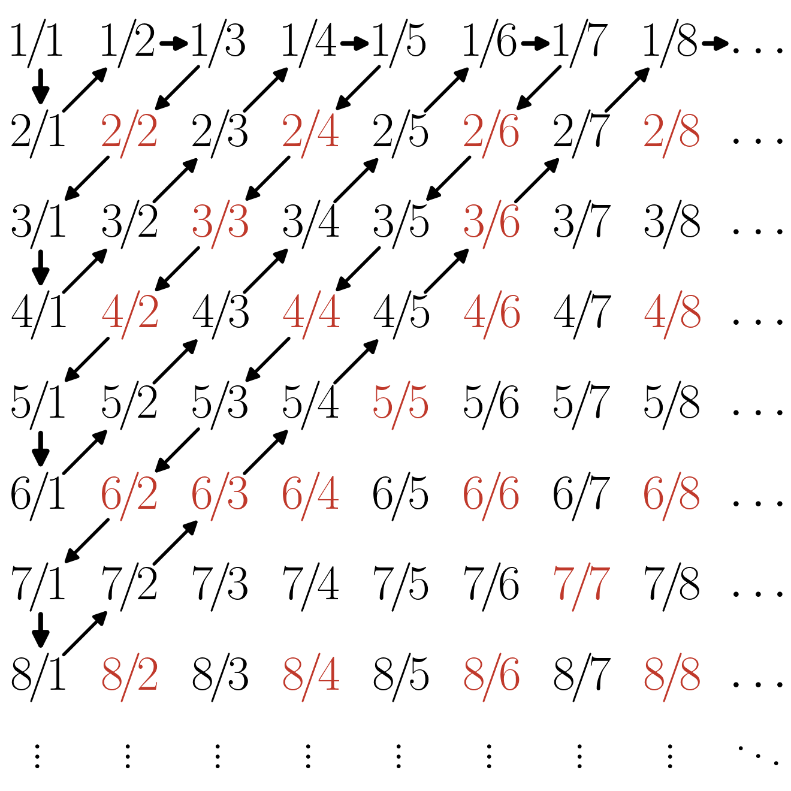{width=55% fig-align="center"}

`(1)` ㉠ 이 성립하는 까닭으로 가장 적절한 것을 고르라.

① 양의 유리수 $\frac{p}{q}$ 는 모두 그림의 $p$ 번째 줄, $q$ 번째 칸에 있고, 화살표는 칸이 유한개인 비스듬한 줄을 차례로 훑으므로 어느 칸이든 유한한 차례에 지나가기 때문이다. \
② 유리수는 셀 수 있는 집합이기 때문이다.

::: {.callout-note collapse="true" title="정답보기(정답률 73% · 보기별 ① 84% · ② 75%)"}
**①**
:::

`(2)` 밑줄 친 ㉡ 에 대한 설명으로 올바른 것을 모두 고르라.

① ㉡ 을 하지 않고 $f(n)=a_n$ 으로 두어도 $f$ 는 $\mathbb{N}$ 에서 $\mathbb{Q}^+$ 로 가는 전사함수이지만, 같은 수가 다시 나오므로 단사함수는 아니다. \
② ㉡ 에서 고르지 않은 항은 모두 앞에 이미 나온 수이므로, 고르지 않아도 $q_1,q_2,q_3,\dots$ 에서 빠지는 양의 유리수는 없다. \
③ ㉡ 을 거친 뒤에도 $f(n)=q_n$ 은 전사함수일 뿐, 단사함수는 아니다. \
④ ㉡ 에서 고르지 않는 항이 끝없이 많으므로, 어느 자연수 $n$ 부터는 $b_n$ 으로 고를 번호가 남지 않는다.

::: {.callout-note collapse="true" title="정답보기(정답률 45% · 보기별 ① 76% · ② 67% · ③ 84% · ④ 78%)"}
**① · ②**
:::

`(3)` (가) 에 들어갈 늘어놓기로 알맞은 것을 모두 고르라.

① $0,\ q_1,\ -q_1,\ q_2,\ -q_2,\ q_3,\ -q_3,\ \dots$ \
② $0,\ q_1,\ q_2,\ -q_1,\ q_3,\ q_4,\ -q_2,\ \dots$ (양수 둘, 음수 하나를 번갈아) \
③ $q_1,\ -q_1,\ q_2,\ -q_2,\ q_3,\ -q_3,\ \dots$ ($0$ 은 넣지 않음)

::: {.callout-note collapse="true" title="정답보기(정답률 22% · 보기별 ① 69% · ② 31% · ③ 71%)"}
**① · ②**
:::

### 문제23

다음은 $|\mathbb{Q}|<|\mathbb{R}|$ 임을 보인 증명이다. 물음에 답하라.

::: {.passage}
$|\mathbb{Q}|<|\mathbb{R}|$ 임을 보이자. $|[0,1]|\leq|\mathbb{R}|$ 이므로 $|\mathbb{Q}|<|[0,1]|$ 임을 보여도 되고, $|\mathbb{N}|=|\mathbb{Q}|$ 이므로 그 대신 $|\mathbb{N}|<|[0,1]|$ 임을 보여도 된다. 이를 위해서는 $\mathbb{N}$ 에서 $[0,1]$ 로 가는 단사함수는 있지만 전사함수는 없음을 보이면 된다. 먼저 단사함수는 (가) 처럼 바로 잡을 수 있다. 전사함수가 없음은 바로 보이기 어려우므로 귀류법을 쓴다. $\mathbb{N}$ 에서 $[0,1]$ 로 가는 전사함수 $f$ 가 있다고 하자. 그러면 [㉠ $[0,1]=\{f(n): n\in\mathbb{N}\}$ 이다]{.underline}. 이제 $a_n=f(n)$ 이라 하고, 수 $y=0.x_1x_2x_3\cdots$ 의 소수점 아래 $n$ 번째 자리 $x_n$ 을 $a_n$ 의 소수점 아래 $n$ 번째 자리와 다른 숫자로 정한다. (단 $x_n$ 은 $0$ 이나 $9$ 가 아니다.) 그러면 [㉡ $y$ 는 $a_1,a_2,a_3,\dots$ 가운데 어디에도 없다]{.underline}. 그런데 $y$ 는 $[0,1]$ 의 수이므로, 이것은 모순이다. 따라서 $\mathbb{N}$ 에서 $[0,1]$ 로 가는 전사함수는 없고, $|\mathbb{N}|<|[0,1]|$ 이다. 곧 $|\mathbb{Q}|<|\mathbb{R}|$ 이다.
:::

`(1)` (가) 에 들어갈 것으로 알맞은 것을 모두 고르라.

① $g(n)=\frac{1}{n}$ \
② $g(n)=n$ \
③ $g(n)=\frac{1}{n+1}$ \
④ $g(n)=\frac{1}{2}$

::: {.callout-note collapse="true" title="정답보기(정답률 33% · 보기별 ① 96% · ② 76% · ③ 51% · ④ 96%)"}
**① · ③**
:::

`(2)` 밑줄 친 ㉠ 에 대한 설명으로 올바른 것을 모두 고르라.

① ㉠ 에 따르면 $[0,1]$ 의 수는 모두 $f(1),f(2),f(3),\dots$ 가운데 어딘가에 나온다. \
② ㉠ 이 성립하려면 서로 다른 $n$ 에 대하여 $f(n)$ 이 모두 달라야 한다. \
③ ㉠ 이 성립하려면 $f(1)<f(2)<f(3)<\cdots$ 처럼 함숫값이 크기 순서로 놓여야 한다.

::: {.callout-note collapse="true" title="정답보기(정답률 33% · 보기별 ① 78% · ② 49% · ③ 80%)"}
**①**
:::

`(3)` $a_1,a_2,a_3,a_4$ 가 아래와 같을 때, 위 증명의 방법으로 만들 수 있는 $y$ 를 하나 골라 소수점 아래 넷째 자리까지 쓰라.

$$a_1=0.5141\cdots,\quad a_2=0.2718\cdots,\quad a_3=0.1454\cdots,\quad a_4=0.3772\cdots$$

::: {.callout-note collapse="true" title="정답보기(정답률 35%)"}
**예: $0.1111$** (소수점 아래 $n$ 번째 자리가 $a_n$ 의 $n$ 번째 자리와 다르고 $0$, $9$ 가 아니면 모두 정답)
:::

`(4)` 밑줄 친 ㉡ 과 그 뒤의 논증에 대한 설명으로 올바른 것을 모두 고르라.

① ㉡ 이 성립하는 것은, 어느 $n$ 에 대해서도 $y$ 와 $a_n$ 의 소수점 아래 $n$ 번째 자리가 다르기 때문이다. \
② $[0,1]$ 의 수를 늘어놓은 어떤 목록에 대해서도 같은 방법으로 그 목록에 없는 $[0,1]$ 의 수를 만들 수 있다. \
③ ㉡ 에 따르면 $y$ 는 $[0,1]$ 의 수가 아니다.

::: {.callout-note collapse="true" title="정답보기(정답률 59% · 보기별 ① 80% · ② 67% · ③ 94%)"}
**① · ② 또는 ① · ② · ③** (복수정답)
:::

### 문제24

두 집합 $X$, $Y$ 를 아래와 같이 두자.

- $X=$ $[0,1]$ 사이의 모든 유리수의 집합
- $Y=$ $[0,1]$

세 학생이 $|X|<|Y|$ 를 보이려고 아래와 같이 논증하였다. 올바른 논증을 모두 고르라.

① $x\mapsto x$ 는 $X$ 에서 $Y$ 로 가는 단사함수이다. 그런데 $\frac{\sqrt2}{2}$ 는 $Y$ 의 원소이지만 유리수가 아니므로 이 함수의 값으로 나오지 않는다. 즉 이 함수는 단사이지만 전사가 아니어서 전단사함수가 아니다. 따라서 $|X|<|Y|$ 이다. \
② $x\mapsto x$ 는 $X$ 에서 $Y$ 로 가는 단사함수이므로 $|X|\le|Y|$ 이다. 만약 $|X|=|Y|$ 라면 전단사함수 $\varphi:X\to Y$ 가 있고, $X$ 는 유리수만 모은 셀 수 있는 집합이므로 $X=\{x_1,x_2,x_3,\dots\}$ 로 쓰면 $Y=\{\varphi(x_1),\varphi(x_2),\varphi(x_3),\dots\}$ 가 되어 $Y$ 도 셀 수 있는 집합이 된다. 그런데 $[0,1]$ 은 셀 수 있는 집합이 아니므로 모순이다. 따라서 $|X|<|Y|$ 이다. \
③ $Y$ 의 길이는 $1$ 이고, $X$ 는 유리수만 모은 집합이라 길이가 $0$ 이다. 길이는 집합이 차지하는 크기이므로, 길이가 더 긴 집합일수록 원소가 더 많고 카디널리티도 더 크다. 따라서 $|X|<|Y|$ 이다.

::: {.callout-note collapse="true" title="정답보기(정답률 10% · 보기별 ① 22% · ② 67% · ③ 55%)"}
**②**
:::

### 문제25

다음은 $|\mathbb{Q}|<|\mathbb{R}-\mathbb{Q}|$ 임을 보이는 증명이다. ($\mathbb{R}-\mathbb{Q}$ 는 무리수 전체의 집합이다.)

::: {.passage}
$|\mathbb{N}|=|\mathbb{Q}|$ 이고 $|\mathbb{Q}|<|\mathbb{R}|$ 임은 이미 보였다. 먼저 $|\mathbb{Q}|\leq|\mathbb{R}-\mathbb{Q}|$ 를 보이는 것은 어렵지 않다. $\mathbb{Q}$ 에서 $\mathbb{R}-\mathbb{Q}$ 로 가는 단사함수를 (가) 처럼 잡으면 되기 때문이다. 이제 $|\mathbb{Q}|\neq|\mathbb{R}-\mathbb{Q}|$ 임을 귀류법으로 보이자. $|\mathbb{Q}|=|\mathbb{R}-\mathbb{Q}|$ 라고 하자. 그러면 [㉠ $\mathbb{Q}=\{q_1,q_2,q_3,\dots\}$, $\mathbb{R}-\mathbb{Q}=\{r_1,r_2,r_3,\dots\}$ 로 쓸 수 있다]{.underline}. 실수는 유리수이거나 무리수이므로, 실수 전체를 (나) 처럼 한 줄로 늘어놓을 수 있다. 이것은 실수가 셀 수 있는 집합이라는 뜻이므로 (다) 와 모순이다. 따라서 $|\mathbb{Q}|\neq|\mathbb{R}-\mathbb{Q}|$ 이고, 앞의 결과와 합치면 $|\mathbb{Q}|<|\mathbb{R}-\mathbb{Q}|$ 이다.
:::

`(1)` (가) 에 들어갈 함수로 알맞은 것을 모두 고르라.

① $f(q)=q+\sqrt{2}$ \
② $f(q)=q\sqrt{2}$ \
③ $f(q)=q+\pi$ \
④ $f(q)=\sqrt{2}$

::: {.callout-note collapse="true" title="정답보기(정답률 37% · 보기별 ① 90% · ② 63% · ③ 65% · ④ 86%)"}
**① · ③**
:::

`(2)` ㉠ 처럼 쓸 수 있는 까닭으로 올바른 것을 모두 고르라.

① $|\mathbb{N}|=|\mathbb{Q}|$ 이므로, 유리수를 자연수 번호를 붙여 빠짐없이, 겹치지 않게 늘어놓을 수 있다. \
② 가정 $|\mathbb{Q}|=|\mathbb{R}-\mathbb{Q}|$ 와 $|\mathbb{N}|=|\mathbb{Q}|$ 에서 $|\mathbb{N}|=|\mathbb{R}-\mathbb{Q}|$ 이므로, 무리수도 그렇게 늘어놓을 수 있다. \
③ 유리수와 무리수는 모두 크기 순서로 늘어놓을 수 있기 때문이다. \
④ ㉠ 은 가정과 상관없이 언제나 성립한다.

::: {.callout-note collapse="true" title="정답보기(정답률 37% · 보기별 ① 73% · ② 82% · ③ 76% · ④ 82%)"}
**① · ②**
:::

`(3)` (나) 에 들어갈 늘어놓기로 알맞은 것을 모두 고르라.

① $q_1,\ r_1,\ q_2,\ r_2,\ q_3,\ r_3,\ \dots$ \
② $r_1,\ q_1,\ r_2,\ q_2,\ r_3,\ q_3,\ \dots$ \
③ $q_1,\ q_2,\ r_1,\ r_2,\ q_3,\ q_4,\ r_3,\ r_4,\ \dots$ (유리수 둘, 무리수 둘을 번갈아) \
④ $r_1,\ r_2,\ q_1,\ q_2,\ r_3,\ r_4,\ q_3,\ q_4,\ \dots$ (무리수 둘, 유리수 둘을 번갈아)

::: {.callout-note collapse="true" title="정답보기(정답률 24% · 보기별 ① 86% · ② 41% · ③ 39% · ④ 31%)"}
**① · ② · ③ · ④**
:::

`(4)` (다) 에 들어갈 것으로 알맞은 것을 고르라.

① $|\mathbb{N}|<|\mathbb{R}|$ \
② $|\mathbb{N}|=|\mathbb{Q}|$

::: {.callout-note collapse="true" title="정답보기(정답률 65% · 보기별 ① 65% · ② 67%)"}
**①**
:::
